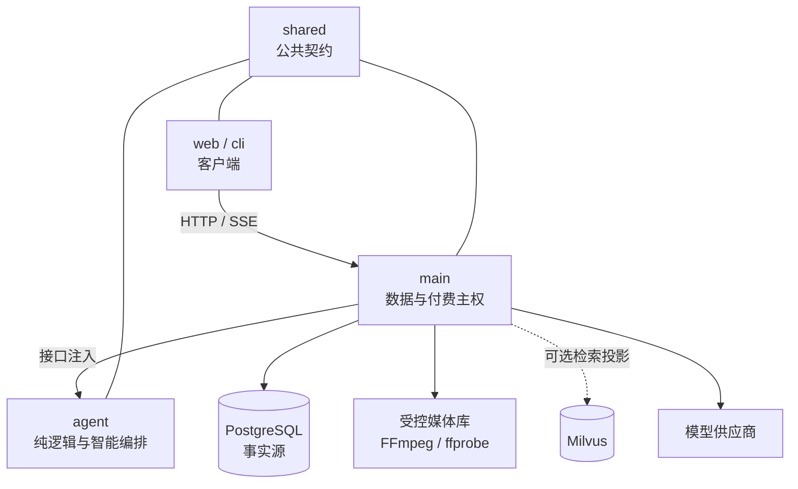

<div align="center">


# Lyra

**把一集剧本，推进成可检查、可恢复、可交付的短剧成片。**

面向中文短剧生产的 AI 制片工作台 · TypeScript monorepo

<p>
  
  
  
  
  
  
  
  
</p>

[产品能力](#产品能力) · [生产流程](#从剧本到成片) · [架构](#monorepo-架构) · [快速开始](#快速开始) · [能力边界](#当前能力边界) · [文档](#文档导航)

</div>

[](packages/main/docs/media/home.png)

Lyra 面向可检查、可恢复、可追溯的短剧生产流程。产品目标不代表当前版本已经完成端到端验收。

## 产品能力

实现状态、代码与测试入口、真实验证记录、owner 和已知限制统一维护在[功能状态与证据](docs/feature-status.md)。README 不复制能力完成度结论。

## 从剧本到成片

生产链路与待完成项请查看[产品 Epic #5](https://github.com/K80Tom/frame-shortdrama-agent/issues/5)，并以[能力台账](docs/feature-status.md)区分实现与验证。

## monorepo 架构

```text
frame-shortdrama-agent/
├── packages/
│   ├── shared/   # 跨包公共契约与领域类型；零服务依赖
│   ├── agent/    # AI 编排、只读工具、估价状态机、小说领域逻辑、方法包索引
│   ├── main/     # NestJS + Fastify API、PostgreSQL、生产 DAG、模型/媒体/预算与迁移
│   ├── web/      # React 19 + Vite 7 工作台；只调用 main API
│   └── cli/      # 命令行客户端；只调用 main API
├── design-system/lyra/  # Lyra 视觉规范与界面说明
├── reference/           # 旧平台精选参考；只读且不参与构建
├── AGENTS.md            # 工程、分支、审核与跨包边界
└── package.json         # monorepo 开发命令
```

### 不可越过的运行边界



1. 只有 `main` 能持有模型密钥、连接 PostgreSQL、写入媒体并执行付费提交。
2. `agent` 不读取密钥、不连接数据库、不监听端口；需要数据时由 `main` 通过接口注入。
3. `web` 与 `cli` 不直连数据库或模型；跨包请求、响应和领域类型统一来自 `@lyra/shared`。
4. 所有付费动作必须遵循“估价/计划 → 人工确认 → 提交”，不存在绕过确认的一键付费入口。

### 数据与依赖

| 依赖 | 用途 | 是否必需 |
| --- | --- | --- |
| Node.js `>=22.19` + npm | 构建和运行全部包 | 必需 |
| PostgreSQL | 项目、小说、资产、运行、助手和治理事实源 | 完整链路必需 |
| FFmpeg / ffprobe | 媒体验真、抽帧、时长/音轨检查和合片 | 成片链路必需 |
| Docker Compose | 快速启动本地 PostgreSQL | 推荐 |
| Milvus + embedding | 可重建的资产相似度检索投影 | 可选 |
| 拆解 / 生图 / 视频模型连接 | 真实模型任务 | 按使用场景配置 |

## 快速开始

### 只体验界面

```sh
git clone https://github.com/K80Tom/frame-shortdrama-agent.git
cd frame-shortdrama-agent
npm run setup
npm run dev:web
```

打开 [http://127.0.0.1:5173](http://127.0.0.1:5173)。仅启动前端可以浏览工作台和本地示例，但不能创建真实生产运行。

### 启动完整本地链路

```sh
npm run setup          # 安装 shared / agent / main / cli / web 依赖
npm run db:up          # 启动本地 PostgreSQL
npm run db:migrate     # 应用数据库迁移
npm run dev            # main API：http://127.0.0.1:8788
```

另开终端：

```sh
npm run dev:web        # Web：http://127.0.0.1:5173
```

真实生产还需要安装 FFmpeg / ffprobe，并在“工作台设置 → 模型连接”中分别配置拆解、生图和视频模型。密钥只保存在本机后端；离线测试不会提交真实付费任务。详细配置见 [本地开发](packages/main/docs/本地开发.md) 与 [独立模型配置](packages/main/docs/独立模型配置.md)。

### 常用验证命令

```sh
npm run build                         # shared → agent → main → cli → web
npm test                              # 完整构建 + 后端测试 + 前端测试
npm --prefix packages/main test       # 后端测试
npm --prefix packages/web test        # 前端测试
npm --prefix packages/main run test:db  # 真实 PostgreSQL 持久化测试
```

### CLI

```sh
npm run cli -- doctor
npm run cli -- project list
npm run cli -- run get <runId>

# create 只生成冻结计划；submit 才提交
npm run cli -- run create --project <id> --script-version <id> --duration 60 --budget 30
npm run cli -- run submit
npm run cli -- run cancel
```

`--api` 或 `OHAO_API` 可切换 API 地址；本机默认 `http://127.0.0.1:8788`。`--json` 输出可供脚本或其他 Agent 消费。

## 界面与演示素材

下面直接展示轻量 GIF 预览，无需先打开附件。需要查看完整画质时，可使用每项下方的高清 MP4 链接。部分素材录制于品牌更名前，画面中的 OHAO / FRAME 名称和旧布局不代表当前页面。

<table>
  <tr>
    <td width="50%" valign="top">
      <strong>14 秒工作台导览</strong><br><br>
      
      <br><a href="https://raw.githubusercontent.com/K80Tom/frame-shortdrama-agent/main/packages/main/docs/media/product-tour.mp4">查看高清 MP4</a>
    </td>
    <td width="50%" valign="top">
      <strong>45 秒功能概览</strong><br><br>
      
      <br><a href="https://raw.githubusercontent.com/K80Tom/frame-shortdrama-agent/main/packages/main/docs/media/promo-45s.mp4">查看完整 MP4</a>
    </td>
  </tr>
  <tr>
    <td width="50%" valign="top">
      <strong>90 秒产品演示</strong><br><br>
      
      <br><a href="https://raw.githubusercontent.com/K80Tom/frame-shortdrama-agent/main/packages/main/docs/media/promo-90s.mp4">查看完整 MP4</a>
    </td>
    <td width="50%" valign="top">
      <strong>自进化页面演示</strong><br><br>
      
      <br><a href="https://raw.githubusercontent.com/K80Tom/frame-shortdrama-agent/main/packages/main/docs/media/evolution-tour.mp4">查看完整 MP4</a>
    </td>
  </tr>
  <tr>
    <td colspan="2" valign="top">
      <strong>单镜头候选样例</strong><br><br>
      
      <br><a href="https://raw.githubusercontent.com/K80Tom/frame-shortdrama-agent/main/packages/main/docs/media/shot-1-preview.mp4">查看完整 MP4</a>
    </td>
  </tr>
</table>

这些素材用于界面和流程说明，不作为模型质量或自动化能力的验收证据。

## 当前能力边界

请以[功能状态与证据](docs/feature-status.md)中的限制为准。历史演示、桩测试和技术媒体检查都不是模型质量验收。

## 协作与发布

- `dev` 是日常集成分支；功能、修复和文档通过短分支 PR 合入 `dev`。
- `main` 是稳定发布分支；只接受 `dev → main` 发布 PR，并要求完整 CI 与非作者真人批准。
- `.github/**`、`AGENTS.md`、`CODEOWNERS`、数据库迁移、公共契约和付费/媒体/预算链路属于高风险范围。
- 具体规则见 [AGENTS.md](AGENTS.md) 和 [工程规范与协作指南](packages/main/docs/工程规范与协作指南.md)。

## 文档导航

先查看[文档有效性目录](docs/documentation-index.md)；历史设计不默认作为当前规范。

| 主题 | 文档 |
| --- | --- |
| 后端功能、启动与路线 | [packages/main/README.md](packages/main/README.md) |
| 自动制片十阶段实现 | [Lyra 全流程自动制片实现](packages/main/docs/Lyra全流程自动制片实现-v0.1.md) |
| 技术架构与数据结构 | [技术架构](packages/main/docs/技术架构.md) · [数据结构](packages/main/docs/数据结构-v0.1.md) |
| 本地开发与模型配置 | [本地开发](packages/main/docs/本地开发.md) · [独立模型配置](packages/main/docs/独立模型配置.md) |
| 小说逐章拆解 | [小说逐章拆解](packages/main/docs/小说逐章拆解.md) |
| 资产自进化 | [asset-evolution.md](packages/main/docs/asset-evolution.md) |
| 前端入口与验证范围 | [packages/web/README.md](packages/web/README.md) · [VERIFICATION.md](packages/web/VERIFICATION.md) |
| 工程和审核规则 | [AGENTS.md](AGENTS.md) |
| 旧平台只读参考 | [reference/README.md](reference/README.md) |
| 需求与反馈 | [GitHub Issues](https://github.com/K80Tom/frame-shortdrama-agent/issues) |

## 许可与第三方代码

3D 导演台和所用组件的来源、适配与许可记录见 [THIRD_PARTY_NOTICES.md](packages/web/THIRD_PARTY_NOTICES.md)。项目目前尚未声明统一开源许可证；使用和分发前请分别核对代码、示例与媒体素材的许可。

---

<div align="center">

**从故事开始，让每个生产节点都可见、可控、可继续。**

[进入完整后端指南](packages/main/README.md) · [查看工程规则](AGENTS.md) · [提交问题](https://github.com/K80Tom/frame-shortdrama-agent/issues)

</div>
