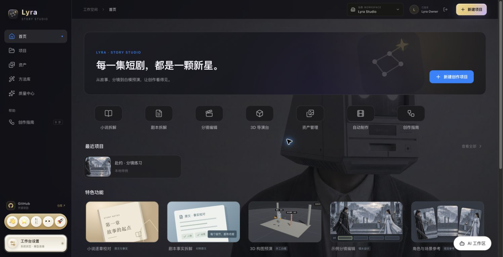
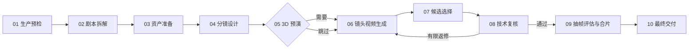
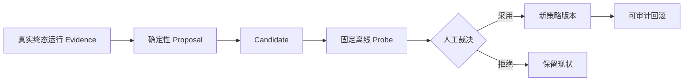
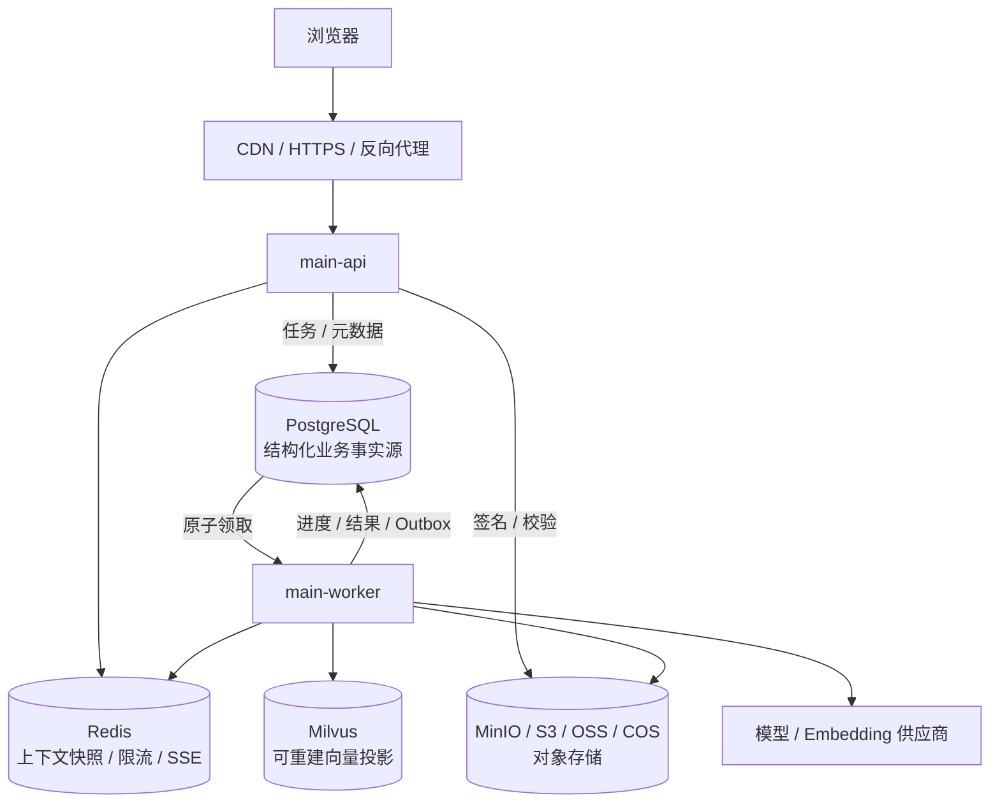
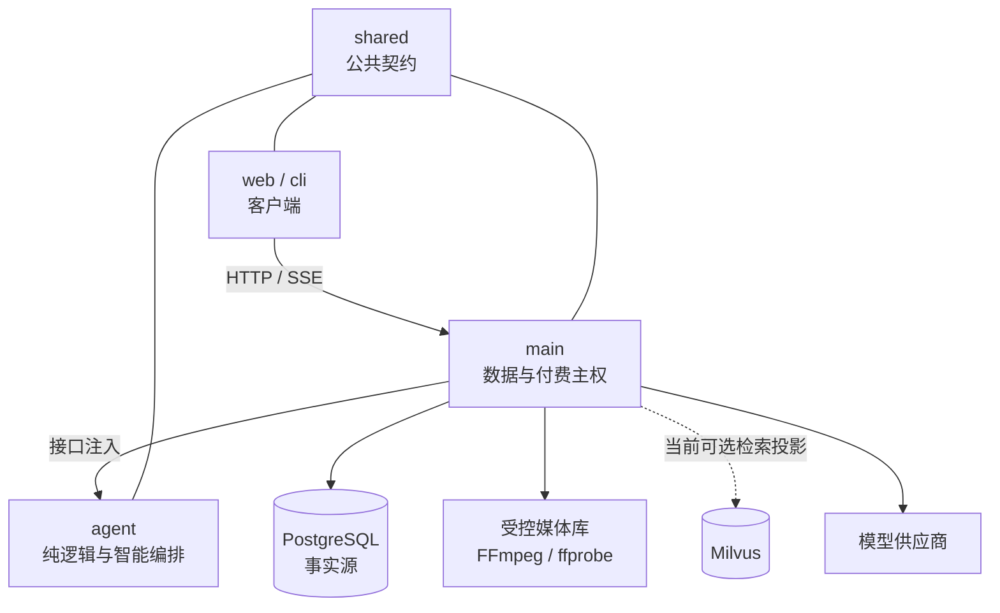
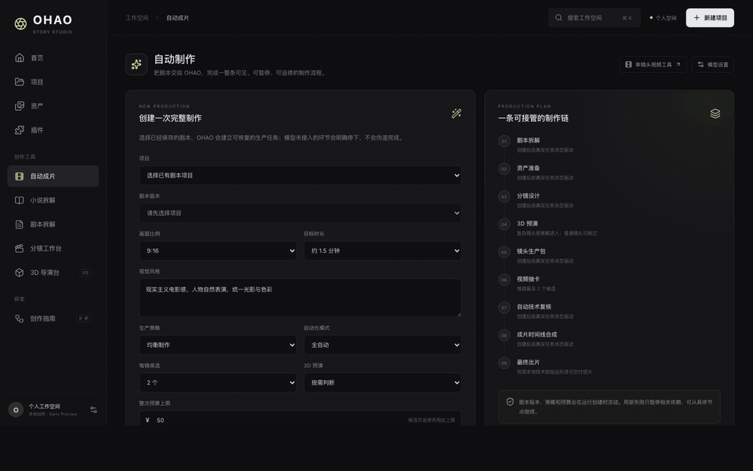
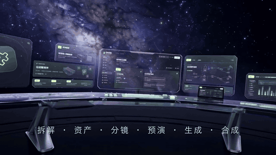
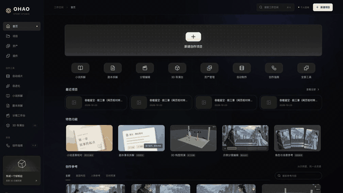

<div align="center">


# Lyra

**把一集剧本，推进成可检查、可恢复、可交付的短剧成片。**

面向中文短剧生产的 AI 制片工作台 · TypeScript monorepo

<p>
  
  
  
  
  
  
  
  
</p>

[产品能力](#产品能力) · [生产流程](#从剧本到成片) · [架构](#架构) · [生产演进](docs/production-architecture-roadmap.md) · [开发环境](#开发环境启动) · [能力边界](#当前能力边界) · [文档](#文档导航)

</div>

[](packages/main/docs/media/home.png)

Lyra 不是单一的“文生视频”按钮。它把小说/剧本拆解、资产准备、分镜设计、空间预演、镜头生成、候选选择、技术复核、有限返修和 FFmpeg 合片组织成一条持久化生产链。每个阶段都有真实状态、冻结输入、预算记录和恢复入口；失败停在具体节点，修复后从受影响的位置继续。

> **当前状态：Early Preview。** 主链路、工作台和 PostgreSQL 持久化已经落地，但模型质量、视觉语义和最终成片仍需要真人验收。生产初版架构已定稿：API/Worker 分进程、PostgreSQL 业务事实源、Redis 对话上下文快照、Milvus 向量检索、MinIO 或 S3/OSS/COS 对象存储与 workspace 租户隔离。当前 `dev` 尚不具备直接公网多租户生产部署条件；后续实现将按已定稿路线迁移，落地状态与升级条件见[生产部署架构与分阶段演进路线](docs/production-architecture-roadmap.md)。

## 产品能力

### 当前工作台

| 区域 | 已实现能力 | 数据状态 |
| --- | --- | --- |
| **首页 / 项目** | 创建项目、浏览近期创作、进入各生产工具 | 项目事实保存到 PostgreSQL |
| **小说拆解** | 逐章提取人物、场景、道具与事实证据；校对、版本化、预览并采用剧本 | 原文、章节、候选与采用结果持久化 |
| **剧本拆解** | 保存真实项目，检查事实候选，人工校对并采用文字拆解 | 拆解版本与审核记录持久化 |
| **资产** | 管理人物、场景、道具及其引用；对缺失资产生成、导入和关联候选 | PostgreSQL 为事实源，媒体进入受控本地库 |
| **分镜工作台** | 编辑镜头、构图与节奏，保留可导出的浏览器草稿 | 正式生产读取冻结版本；部分编辑草稿仍为本地状态 |
| **3D 导演台** | 调整人物站位、机位、焦距、运镜和构图，导出空间预演参考 | 当前主要生成 prompt 级空间约束 |
| **自动成片** | 创建整集运行，查看阶段轨道、镜头任务、问题、预算、时间线和交付物 | 十阶段运行可暂停、恢复和局部重试 |
| **自进化** | 从真实终态运行生成可审计提案，经离线 Probe 后人工采用或回滚 | 当前治理资产 RAG 策略，不自动改写资产 |
| **方法包** | 搜索、查看许可与正文、启停、导入 `.md/.txt`，运行创建时冻结启用版本 | 需要应用数据库迁移 `020–021` |
| **插件 / 设置** | 查看可用工具，按用途配置拆解、生图和视频模型连接 | 密钥只保存在后端，不进入浏览器 |

### AI 工作区

全局右侧面板可通过浮动按钮或 `⌘J / Ctrl+J` 打开，把“查询生产事实”和“发起生产”放进同一个对话：

- 使用 SSE 输出正文、工具调用、估价卡、完成和错误事件；会话刷新后可回放。
- 只允许调用经过白名单和字段裁剪的项目、运行、资产查询工具；模型发明的工具会被拒绝。
- 付费请求只生成冻结的**估价确认卡**；用户点击“确认并提交”后才会创建运行，建卡本身不扣费。
- 模型连接缺失或调用失败时返回真实错误，不伪造回答或生产结果。

编排与状态机位于 `packages/agent`，HTTP/SSE、数据库和付费提交位于 `packages/main`，界面位于 `packages/web/src/assistant/`。

## 从剧本到成片



- **事实先行**：拆解结果保留原文证据，资产只按名称和别名匹配；同优先级歧义会暂停，不猜选。
- **输入冻结**：创建运行后冻结剧本版本、制作策略、方法包和预算，不随项目后续编辑静默变化。
- **预算闭环**：付费任务先预留预算，完成后结算，失败时释放；稳定请求 ID、CAS 与 outbox 防止重复提交。
- **未知状态不重提**：供应商返回不明确时只查询原任务，不能确认则转人工处理，避免重复付费。
- **局部失败局部返修**：返修携带上一轮真实失败项，只让受影响的下游节点失效，不重跑整集。
- **媒体先验真再使用**：外部媒体经过安全下载、SHA-256 与 `ffprobe` 校验后，才进入候选评分和 FFmpeg 合片。

### 三种运行模式

| 模式 | 行为 |
| --- | --- |
| **全自动** | 自动采用通过确定性检查的节点，自动选择技术推荐候选；遇到预算、歧义和未知外部状态仍会暂停。 |
| **关键节点确认** | 在拆解、资产、分镜、候选和交付等关键阶段等待用户确认。 |
| **共同导演** | 每个可见阶段都保留人工检查点，适合逐镜控制。 |

## 自进化与方法包

### 可回滚的资产策略进化

自进化不是让模型直接修改生产数据，而是一个受控治理闭环：



当前范围只覆盖资产 RAG 策略：它不会自动修改资产、不会自动重建 Milvus，也不能据此证明视觉质量提升。详见 [资产自进化说明](packages/main/docs/asset-evolution.md)。

### 运行时冻结的方法包

方法包用于保存可检索的创作方法、许可信息和节点级提示参考。系统按需读取正文，创建生产运行时冻结当时启用的版本，只在匹配的模型节点附加节选，避免方法在运行中漂移。内置方法索引位于 [`packages/agent/prompt-library`](packages/agent/prompt-library/README.md)。

## 架构

### 生产初版目标



- PostgreSQL 保存用户、workspace、项目、完整对话、任务、权限、费用和 Outbox。
- Redis 是必需的热上下文层，但其快照必须能从 PostgreSQL 重建。
- Milvus 是必需的语义检索层，但命中后仍回 PostgreSQL 核验租户、权限和当前版本。
- 图片、音频、视频和成片进对象存储；每个环境选择 MinIO、S3、OSS 或 COS 之一。
- API 和 Worker 仍属于同一 `@lyra/main` 与同一仓库，只拆运行进程，不为此提前拆微服务。

> 上图是已定稿的 Stage 1 目标拓扑。当前 `dev` 尚未完成 Redis、对象存储、多租户与 API/Worker 分进程的全部迁移；详细现状、一致性、回滚和验收要求见[生产架构路线](docs/production-architecture-roadmap.md)。

### 当前 monorepo 代码边界

```text
frame-shortdrama-agent/
├── packages/
│   ├── shared/   # 跨包公共契约与领域类型；零服务依赖
│   ├── agent/    # AI 编排、只读工具、估价状态机、小说领域逻辑、方法包索引
│   ├── main/     # NestJS + Fastify API、PostgreSQL、生产 DAG、模型/媒体/预算与迁移
│   ├── web/      # React 19 + Vite 7 工作台；只调用 main API
│   └── cli/      # 命令行客户端；只调用 main API
├── design-system/lyra/  # Lyra 视觉规范与界面说明
├── reference/           # 旧平台精选参考；只读且不参与构建
├── AGENTS.md            # 工程、分支、审核与跨包边界
└── package.json         # monorepo 开发命令
```

### 当前不可越过的运行边界



1. 只有 `main` 能持有模型密钥、连接 PostgreSQL、写入媒体并执行付费提交。
2. `agent` 不读取密钥、不连接数据库、不监听端口；需要数据时由 `main` 通过接口注入。
3. `web` 与 `cli` 不直连数据库或模型；跨包请求、响应和领域类型统一来自 `@lyra/shared`。
4. 所有付费动作必须遵循“估价/计划 → 人工确认 → 提交”，不存在绕过确认的一键付费入口。

### 生产初版依赖与当前状态

| 依赖 | 当前 `dev` | 生产初版 |
| --- | --- | --- |
| Node.js `>=22.19` + npm | 构建和运行全部包 | 继续作为应用运行时 |
| PostgreSQL | 项目、小说、资产、运行、助手和治理事实源 | 继续作为结构化业务状态与元数据的唯一事实源，增加租户模型、可恢复任务和备份 |
| Redis | 未接入 | 必需；对话上下文快照、限流、SSE 事件广播/临时流和短期协调 |
| Milvus + embedding | 可选的资产检索投影 | 必需；携带 `workspace_id` 的可重建向量索引 |
| 对象存储 | 媒体进入受控本地库 | 必需；私有化用 MinIO，云环境选 S3、OSS 或 COS 之一 |
| FFmpeg / ffprobe | 媒体验真、抽帧、音轨检查和合片 | 继续由媒体 Worker 使用，独立限制 CPU/内存并发 |
| 模型连接 | 按拆解、生图、视频等用途配置 | 平台密钥进 Secret Manager，BYOK 按 workspace 加密保存 |

## 开发环境启动

### 体验界面

```sh
git clone https://github.com/K80Tom/frame-shortdrama-agent.git
cd frame-shortdrama-agent
npm run setup
npm run dev:web
```

打开 [http://127.0.0.1:5173](http://127.0.0.1:5173)。仅启动前端可以浏览工作台和示例，但不能创建真实生产运行。

### 启动当前开发链路

```sh
npm run setup          # 安装 shared / agent / main / cli / web 依赖
npm run db:up          # 启动本地 PostgreSQL
npm run db:migrate     # 应用数据库迁移
npm run dev            # main API：http://127.0.0.1:8788
```

另开终端：

```sh
npm run dev:web        # Web：http://127.0.0.1:5173
```

执行真实生成链路还需要安装 FFmpeg / ffprobe，并在“工作台设置 → 模型连接”中分别配置拆解、生图和视频模型。当前开发配置与生产初版的 Secret Manager/KMS 目标不同；离线测试不会提交真实付费任务。开发配置见 [本地开发](packages/main/docs/本地开发.md) 与 [独立模型配置](packages/main/docs/独立模型配置.md)；生产部署见[架构演进路线](docs/production-architecture-roadmap.md)。

### 常用验证命令

```sh
npm run build                         # shared → agent → main → cli → web
npm test                              # 完整构建 + 后端测试 + 前端测试
npm --prefix packages/main test       # 后端测试
npm --prefix packages/web test        # 前端测试
npm --prefix packages/main run test:db  # 真实 PostgreSQL 持久化测试
```

### CLI

```sh
npm run cli -- doctor
npm run cli -- project list
npm run cli -- run get <runId>

# create 只生成冻结计划；submit 才提交
npm run cli -- run create --project <id> --script-version <id> --duration 60 --budget 30
npm run cli -- run submit
npm run cli -- run cancel
```

`--api` 或 `OHAO_API` 可切换 API 地址；本机默认 `http://127.0.0.1:8788`。`--json` 输出可供脚本或其他 Agent 消费。

## 界面与演示素材

下面直接展示轻量 GIF 预览，无需先打开附件。需要查看完整画质时，可使用每项下方的高清 MP4 链接。部分素材录制于品牌更名前，画面中的 OHAO / FRAME 名称和旧布局不代表当前页面。

<table>
  <tr>
    <td width="50%" valign="top">
      <strong>14 秒工作台导览</strong><br><br>
      
      <br><a href="https://raw.githubusercontent.com/K80Tom/frame-shortdrama-agent/main/packages/main/docs/media/product-tour.mp4">查看高清 MP4</a>
    </td>
    <td width="50%" valign="top">
      <strong>45 秒功能概览</strong><br><br>
      
      <br><a href="https://raw.githubusercontent.com/K80Tom/frame-shortdrama-agent/main/packages/main/docs/media/promo-45s.mp4">查看完整 MP4</a>
    </td>
  </tr>
  <tr>
    <td width="50%" valign="top">
      <strong>90 秒产品演示</strong><br><br>
      
      <br><a href="https://raw.githubusercontent.com/K80Tom/frame-shortdrama-agent/main/packages/main/docs/media/promo-90s.mp4">查看完整 MP4</a>
    </td>
    <td width="50%" valign="top">
      <strong>自进化页面演示</strong><br><br>
      
      <br><a href="https://raw.githubusercontent.com/K80Tom/frame-shortdrama-agent/main/packages/main/docs/media/evolution-tour.mp4">查看完整 MP4</a>
    </td>
  </tr>
  <tr>
    <td colspan="2" valign="top">
      <strong>单镜头候选样例</strong><br><br>
      
      <br><a href="https://raw.githubusercontent.com/K80Tom/frame-shortdrama-agent/main/packages/main/docs/media/shot-1-preview.mp4">查看完整 MP4</a>
    </td>
  </tr>
</table>

这些素材用于界面和流程说明，不作为模型质量或自动化能力的验收证据。

## 当前能力边界

- **技术复核不等于视觉语义审核。** 系统可以校验容器、哈希、画幅、时长、音轨和分辨率，但不能自动证明人物、动作、台词、表演、剧情或镜头连续性正确。
- **3D 当前主要是 `prompt-only`。** 机位、焦距、运镜和站位会转为文字构图约束；尚未把 3D 渲染图或供应商原生相机参数直接提交给视频模型。
- **声音依赖视频供应商原生音轨。** 独立配音、口型同步、音效、配乐、混音、字幕生成与烧录尚未形成完整子图。
- **生产初版迁移尚未完成。** API/Worker 分进程、Redis 对话快照、对象存储、Milvus 租户化投影和完整 workspace 授权已纳入 Stage 1，但只有在对应代码、迁移、测试和部署清单完成后才视为已实现。
- **真实模型质量必须人工验证。** 模型未配置时系统不会伪造结果；只有用户明确授权预算并检查产物后，才能判断供应商能力。

## 协作与发布

- `dev` 是日常集成分支；功能、修复和文档通过短分支 PR 合入 `dev`。
- `main` 是稳定发布分支；只接受 `dev → main` 发布 PR，并要求完整 CI 与非作者真人批准。
- `.github/**`、`AGENTS.md`、`CODEOWNERS`、数据库迁移、公共契约和付费/媒体/预算链路属于高风险范围。
- 具体规则见 [AGENTS.md](AGENTS.md) 和 [工程规范与协作指南](packages/main/docs/工程规范与协作指南.md)。

## 文档导航

| 主题 | 文档 |
| --- | --- |
| 后端功能、启动与路线 | [packages/main/README.md](packages/main/README.md) |
| 生产初版、增长期与规模化架构 | [生产部署架构与分阶段演进路线](docs/production-architecture-roadmap.md) |
| 自动制片十阶段实现 | [Lyra 全流程自动制片实现](packages/main/docs/Lyra全流程自动制片实现-v0.1.md) |
| 技术架构与数据结构 | [技术架构](packages/main/docs/技术架构.md) · [数据结构](packages/main/docs/数据结构-v0.1.md) |
| 本地开发与模型配置 | [本地开发](packages/main/docs/本地开发.md) · [独立模型配置](packages/main/docs/独立模型配置.md) |
| 小说逐章拆解 | [小说逐章拆解](packages/main/docs/小说逐章拆解.md) |
| 资产自进化 | [asset-evolution.md](packages/main/docs/asset-evolution.md) |
| 前端入口与验证范围 | [packages/web/README.md](packages/web/README.md) · [VERIFICATION.md](packages/web/VERIFICATION.md) |
| 工程和审核规则 | [AGENTS.md](AGENTS.md) |
| 旧平台只读参考 | [reference/README.md](reference/README.md) |
| 需求与反馈 | [GitHub Issues](https://github.com/K80Tom/frame-shortdrama-agent/issues) |

## 许可与第三方代码

3D 导演台和所用组件的来源、适配与许可记录见 [THIRD_PARTY_NOTICES.md](packages/web/THIRD_PARTY_NOTICES.md)。项目目前尚未声明统一开源许可证；使用和分发前请分别核对代码、示例与媒体素材的许可。

---

<div align="center">

**从故事开始，让每个生产节点都可见、可控、可继续。**

[进入完整后端指南](packages/main/README.md) · [查看工程规则](AGENTS.md) · [提交问题](https://github.com/K80Tom/frame-shortdrama-agent/issues)

</div>
