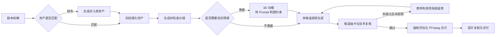

<div align="center">

<h1>Lyra</h1>

<p><strong>把一集剧本，自动推进成可检查、可恢复、可交付的短剧成片。</strong></p>

<p>面向中文短剧的 AI 制片工作台 · monorepo</p>

<p>
  
  
  
  
  
</p>

<p>
  <a href="#一条可以停下来检查的自动化制片线">自动制片</a> ·
  <a href="#三种自动化模式">运行模式</a> ·
  <a href="#ai-工作区">AI 工作区</a> ·
  <a href="#界面预览">界面预览</a> ·
  <a href="#monorepo-架构">架构</a> ·
  <a href="#快速开始">快速开始</a>
</p>

</div>

[](packages/main/docs/media/automation.png)

Lyra 的核心不是再增加一个"文生视频"按钮，而是把剧本拆解、资产准备、分镜、镜头生成、复核、返修和合片连接成一次完整的生产运行。每一步都有状态和输入，失败可以停在具体节点；刷新页面或重启服务后，可以从 PostgreSQL 保存的进度继续。

## 一条可以停下来检查的自动化制片线

如果从小说开始，在「小说拆解」选择已拆解的章节或全书，点击「预览剧本」。采用后会打开已选好项目和剧本版本的制片表单，再确认本次预算。[小说转剧本操作说明](packages/main/docs/小说逐章拆解.md)

创建运行时，只需选择项目和剧本版本，设置画幅、目标时长、视觉风格、质量档位、每镜候选数、3D 策略与预算。Lyra 随后按同一个持久化流程推进整集制作：



这条流程已经落地为可运行的十阶段 DAG：

- **拆解与采用**：从固定剧本版本提取人物、地点、道具和对白事实，经过确定性检查后由 Agent 或用户采用。
- **资产匹配与补全**：按名称和别名匹配人物、场景、道具；缺失项才进入图片生成。同优先级出现歧义时暂停，不猜选、不重复消费。
- **分镜与 3D 约束**：生成并检查有序分镜；复杂镜头可按规则建立白模快照，把机位、焦距、运镜和人物站位转成文字构图约束。
- **镜头候选与返修**：每个镜头可生成多份视频候选，引用已冻结的资产图；失败项会进入有次数上限的局部返修，而不是重跑整集。
- **评估、合片与交付**：候选进入本地私有媒体库，经哈希与 `ffprobe` 校验；可按抽帧评估结果决定镜头的加速与裁剪，再按分镜顺序使用 FFmpeg 生成整集 MP4。

## 三种自动化模式

| 模式 | 适合谁 | 执行方式 |
| --- | --- | --- |
| **全自动** | 希望一次创建后持续推进 | 自动采用通过检查的拆解与分镜，自动选择技术推荐候选，并在质量档位允许范围内局部返修。 |
| **关键节点确认** | 希望控制重要决策 | 在拆解、资产、分镜和交付等阶段停下确认，视频候选由用户选择。 |
| **共同导演** | 希望逐阶段介入 | 每个可见制作阶段都进入人工检查点，适合精细控制镜头。 |

无论选择哪种模式，预算不足、配置缺失、关键事实不明确、外部任务状态未知、技术检查失败或重试次数用尽时，流程都会暂停并给出具体问题。

### 自动运行，也保留控制权

- **一次运行，一次授权**：付费调用必须在创建运行时明确勾选，并受本次预算上限约束；每项任务先预留、再结算或释放预算。
- **刷新和重启可恢复**：任务、尝试、候选、产物、问题、时间线和预算流水保存在 PostgreSQL；页面可暂停、继续和局部重试。
- **未知任务不重复提交**：供应商结果不明时只查询原任务。无法确认后转为人工处理，避免再次提交同一付费任务。
- **局部失败局部返修**：返修会携带上一轮真实技术失败项，并只让受影响的下游节点失效。
- **输入保持冻结**：运行开始后，剧本版本、制作策略和预算不会随项目后续编辑静默变化。

## AI 工作区

工作台右侧内置 AI 工作区（浮动按钮或 `⌘J / Ctrl+J` 开合），把"问数据"和"发起生产"放进同一个对话里：

- **流式对话**：SSE 事件协议承载正文增量、思考段、工具开始/结束、估价卡、完成与错误；会话与消息落库，刷新后可回放。
- **白名单只读工具**：助手只能查询项目、生产运行与资产等真实数据，工具名、参数与返回字段都被裁剪和校验，模型发明的工具直接拒绝。
- **对话内的付费闭环**：提出"帮我生成 60 秒成片"时，助手只产出**估价确认卡**——冻结请求、按预算计价、15 分钟有效、超预算护栏拒建；点击"确认并提交"才创建生产运行，重复提交幂等。**建卡不扣费。**
- **禁 mock**：模型未配置或调用失败时如实显示错误，不生成模拟回答。

实现位于 `packages/agent`（编排与状态机）与 `packages/main`（HTTP/SSE 与 PostgreSQL 持久化），前端为 `packages/web/src/assistant/`。

## 界面预览

<table>
  <tr>
    <td width="50%"><strong>首页</strong><br></td>
    <td width="50%"><strong>项目</strong><br></td>
  </tr>
  <tr>
    <td width="50%"><strong>资产</strong><br></td>
    <td width="50%"><strong>插件与工具</strong><br></td>
  </tr>
</table>

自动制作页在同一个界面展示阶段轨道、镜头任务矩阵、问题收件箱、候选选择、预算摘要、事件时间线和最终交付：

[](packages/main/docs/media/automation-tour.png)

<details>
<summary><strong>产品导览（GIF / MP4）与宣传视频</strong></summary>

[](packages/main/docs/media/product-tour.mp4?raw=true)

<p align="center">
  <a href="packages/main/docs/media/product-tour.mp4?raw=true">查看 / 下载 14 秒界面导览</a> ·
  <a href="packages/main/docs/media/promo-45s.mp4?raw=true">45 秒功能概览</a> ·
  <a href="packages/main/docs/media/promo-90s.mp4?raw=true">90 秒产品宣传片</a> ·
  <a href="packages/main/docs/media/evolution-tour.mp4?raw=true">自进化页面演示</a>
</p>

<sub>导览与宣传片用于产品展示，其中的动画、包装和示例画面不作为自动化能力验收证据。部分素材录制于品牌更名前，画面中的 OHAO 为历史界面记录，产品名称现已统一为 Lyra。</sub>

</details>

## monorepo 架构

```text
frame-shortdrama-agent/
├── packages/
│   ├── shared/   # 公共契约：模型与生产的请求/响应、错误、资产与小说领域类型（零服务依赖）
│   ├── main/     # 数据与付费主权：NestJS API + PostgreSQL + 生产 DAG + 媒体链 + 模型密钥 + 迁移
│   ├── agent/    # 智能能力层：AI 工作区编排、只读工具、估价状态机（无状态、不持密钥、不连数据库）
│   ├── web/      # React 工作台（含 AI 工作区侧栏），只调 main 的 HTTP API
│   └── cli/      # 命令行客户端，只调 main 的 HTTP API；付费遵循 计划 → 人工确认 → 提交
├── reference/    # 旧平台精选参考（合同 / 架构 / 拆解实现，只读，不参与构建）
└── AGENTS.md     # 工程规则与跨包硬约束
```

**边界（写进 AGENTS.md 的硬约束）**

1. 只有 `main` 能持有模型密钥、连接 PostgreSQL、执行付费提交。
2. `agent` 不 import 数据库驱动、不读取密钥环境变量；需要数据时通过接口由 `main` 注入实现。
3. `web` 与 `cli` 只是客户端，运行时只走 `main` 的 API，不直连模型或数据库；共享类型统一来自 `@lyra/shared`。
4. 任何付费动作都必须"估价/计划 → 人工确认 → 提交"，不留一键到底的后门。

这样的划分是为**上线预留**的：现在一台机器、本地 PG 与文件存储即可开发；以后 `main`/`agent` 可分开部署，`agent` 的接口实现换成 HTTP、存储换成云 PG 与对象存储，都只动适配层。

## 命令行客户端

```sh
npm run cli -- doctor                 # 后端连通性与模型配置
npm run cli -- project list           # 项目列表
npm run cli -- project get <id>       # 项目详情
npm run cli -- run get <runId>        # 运行状态与阻断原因

# 付费纪律：create 只生成计划（不提交、不扣费），submit 才提交同一份冻结请求
npm run cli -- run create --project <id> --script-version <id> --duration 60 --budget 30
npm run cli -- run submit             # 确认并提交
npm run cli -- run cancel             # 丢弃待提交计划
```

- `--api` 或 `OHAO_API` 可指向其他环境（本机默认 `http://127.0.0.1:8788`），`OHAO_TOKEN` 可附加访问令牌。
- `--json` 输出便于脚本、定时任务与其他 Agent 消费；命令成功只代表该阶段成功，不代表成片已生成。

## 快速开始

### 先体验界面

准备 **Node.js ≥ 22.19** 和 npm。仅浏览界面、示例分镜和手工 3D 导演台时，不需要数据库或模型账号。

```sh
git clone https://github.com/K80Tom/frame-shortdrama-agent.git frame
cd frame
npm run setup
npm run dev:web
```

打开 [http://127.0.0.1:5173](http://127.0.0.1:5173)；自动制作入口为 `#/automation`。仅启动前端时可以浏览界面，但不能创建真实生产运行。

### 启动完整本地链路

准备 Docker Desktop 或其他可用的 Docker Compose 环境，在仓库根目录执行：

```sh
npm run setup          # 安装各包依赖
npm run db:up          # 启动本地 PostgreSQL
npm run db:migrate     # 应用迁移
npm run dev            # 启动 main：http://127.0.0.1:8788
```

另开终端启动前端：

```sh
npm run dev:web        # http://127.0.0.1:5173
```

完整生产运行需要本机配置拆解、生图和生视频等用途对应的模型连接，并安装可用的 FFmpeg / ffprobe。密钥只保存在本机后端，不进入浏览器或仓库；只有用户对某次运行明确授权预算后，该次运行才可能调用付费模型。详细步骤见 [main 包指南](packages/main/README.md) 和 [本地开发](packages/main/docs/本地开发.md)。

<details>
<summary><strong>开发验证命令</strong></summary>

```sh
npm test                              # 构建 shared/agent/main/cli/web 并运行全部测试
npm --prefix packages/main test       # 仅后端测试
npm --prefix packages/web test        # 仅前端测试
npm --prefix packages/main run test:db  # 真实 PostgreSQL 持久化测试（需已启动并迁移）
```

以上测试不会提交真实付费模型任务。

</details>

## 当前能力边界

Lyra 目前是 **Early Preview**。自动化编排、持久化恢复、镜头级子图、本地媒体校验、有限返修、FFmpeg 合片和总控 UI 已实现，但需要明确理解以下边界：

- **技术复核不是视觉语义审核。** 自动检查验证容器与哈希，检查画幅、时长和音轨，并读取分辨率参与候选评分；它不能证明人物长相、动作、剧情、台词、表演和镜头连续性正确，也不能替代人工观看。
- **3D 目前是 `prompt-only` 约束。** 系统把规则式白模的机位、焦距、运镜和站位写入视频提示词；没有把 3D 渲染图或供应商原生相机控制参数传给视频模型。
- **声音使用视频供应商的原生音轨。** 当前没有独立配音、口型同步、音效、配乐、混音和字幕生成或烧录子图。
- **真实生成依赖本机配置和授权。** 离线测试、前端预览和构建不会调用模型；模型质量只有在连接配置完成、用户明确授权一次预算并人工检查产物后才能验证。
- **仍是本地单机部署。** 当前没有分布式调度、对象存储、CDN 和多用户权限系统（包结构已为上线预留边界）。

## 文档导航

| 想了解什么 | 从这里开始 |
| --- | --- |
| 后端完整启动、功能和路线图 | [packages/main/README.md](packages/main/README.md) |
| 自动制片的十阶段实现、恢复、预算与媒体链 | [全流程自动制片实现](packages/main/docs/Lyra全流程自动制片实现-v0.1.md) |
| 真实跑批暴露的问题、根因与重构记录 | [流程问题诊断与重构](packages/main/docs/流程问题诊断与重构-v0.1.md) |
| 产品目标和自动化构思 | [总体设计](packages/main/docs/总体设计.md) · [自动制片构思](packages/main/docs/Lyra全流程自动制片构思-v0.1.md) |
| 后端、数据库和本地开发 | [技术架构](packages/main/docs/技术架构.md) · [本地开发](packages/main/docs/本地开发.md) |
| 数据结构和生产聚合 | [数据结构 v0.1](packages/main/docs/数据结构-v0.1.md) |
| 模型连接和调用限制 | [独立模型配置](packages/main/docs/独立模型配置.md) · [模型接入](packages/main/docs/模型接入.md) |
| 前端入口与验证范围 | [packages/web/README.md](packages/web/README.md) · [工作台验证记录](packages/web/VERIFICATION.md) |
| 工程规则与跨包约束 | [AGENTS.md](AGENTS.md) |
| 旧平台设计与合同参考 | [reference/README.md](reference/README.md) |
| 反馈问题或提出想法 | [GitHub Issues](https://github.com/K80Tom/frame-shortdrama-agent/issues) |

## 来源与许可

3D 导演台和所用组件的来源、适配与许可记录见 [第三方代码说明](packages/web/THIRD_PARTY_NOTICES.md)。旧平台仅存的参考资料位于 `reference/`，完整历史工程可从 Git 历史找回。项目尚未声明统一开源许可证；使用与分发时请核对各代码、样例和素材的来源与许可。

---

<div align="center">
  <p><strong>从剧本开始，让每个生产节点都可见、可控、可继续。</strong></p>
  <p><a href="packages/main/README.md">进入 Lyra 完整指南 →</a></p>
</div>
