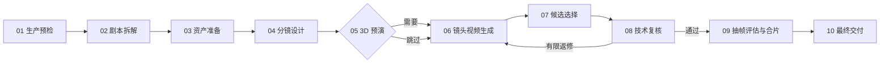
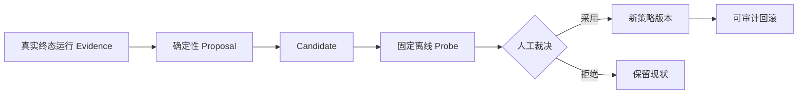
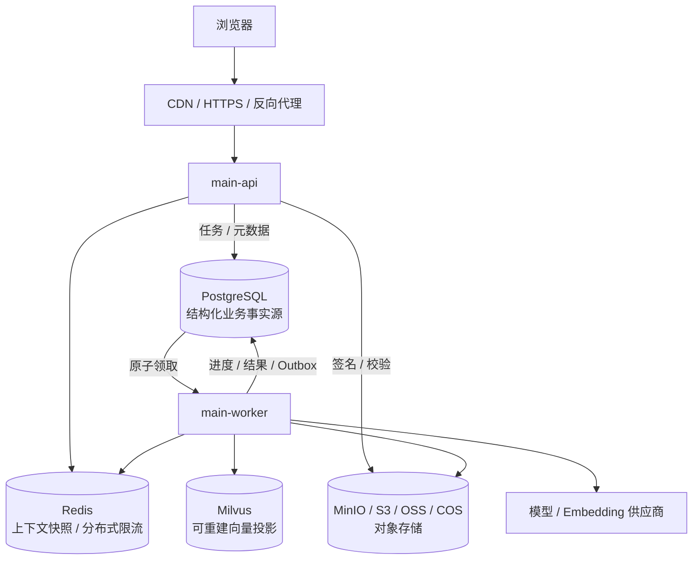
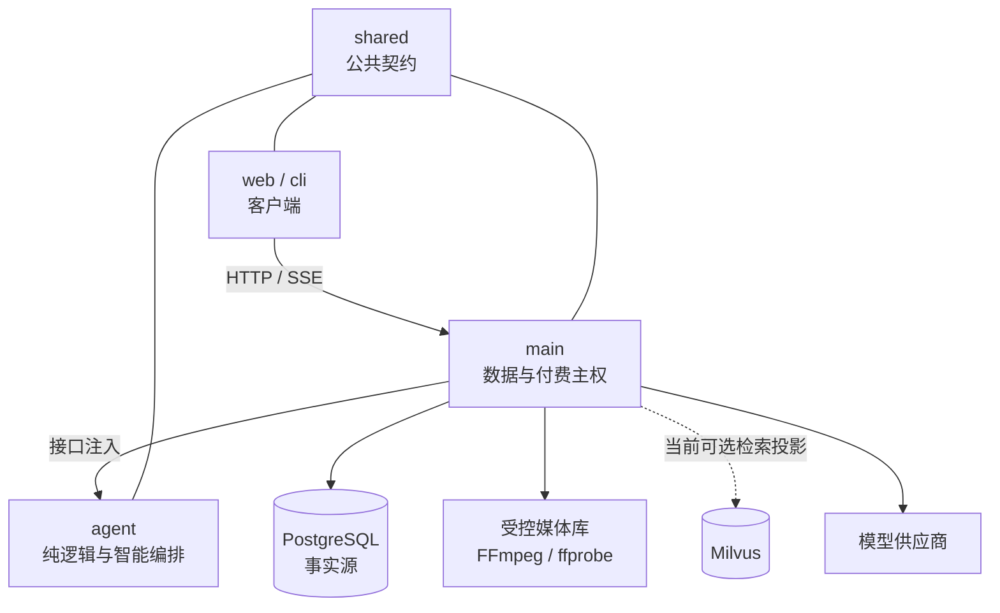
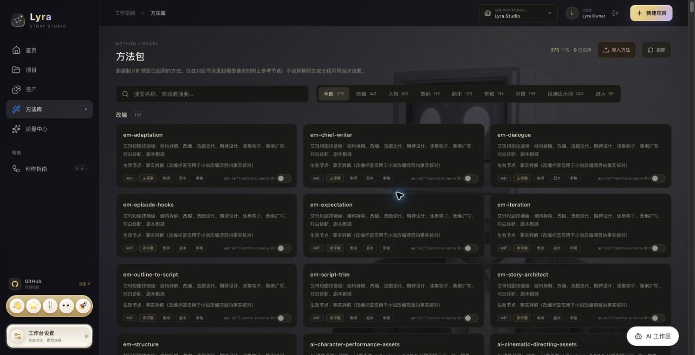
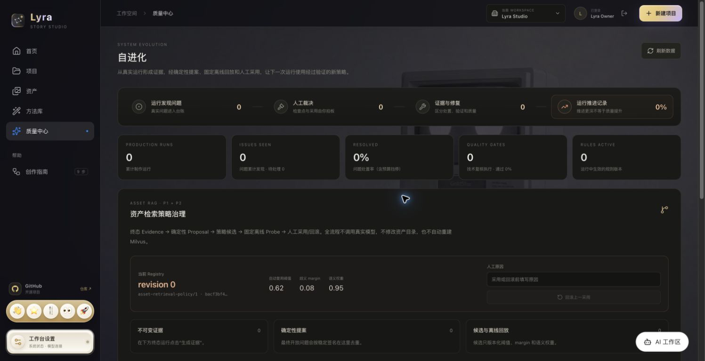

<div align="center">


# Lyra

**把一集剧本，推进成可检查、可恢复、可交付的短剧成片。**

面向中文短剧生产的 AI 制片工作台 · TypeScript monorepo

<p>
  
  
  
  
  
  
  
  
  
</p>

[产品能力](#产品能力) · [生产流程](#从剧本到成片) · [架构](#架构) · [生产演进](docs/production-architecture-roadmap.md) · [Stage-1 部署](#stage-1-部署) · [能力边界](#当前能力边界) · [文档](#文档导航)

</div>

[](packages/main/docs/media/home.png)

Lyra 不是单一的“文生视频”按钮。它把小说/剧本拆解、资产准备、分镜设计、空间预演、镜头生成、候选选择、技术复核、有限返修和 FFmpeg 合片组织成一条持久化生产链。每个阶段都有真实状态、冻结输入、预算记录和恢复入口；失败停在具体节点，修复后从受影响的位置继续。

> **当前状态：v0.2.0 / Stage 1 单受信 workspace 试运行。** 主链路、工作台和 PostgreSQL 事实源已落地；本版本加入 API/Worker 分进程、workspace 与会话认证、迁移管理员/非特权应用账号分离、租户表 `FORCE RLS`、可恢复任务与租户化 Outbox、Redis 对话快照与分布式限流、Milvus v2 租户向量投影任务、MinIO/S3/OSS/COS 生产媒体对象投影与签名访问入口，以及单机 Compose 拓扑。旧业务调度迁移、资产图片对象化、签名公网 endpoint/授权边界验证与对象 GC、向量全量回填、密钥托管、备份/PITR 与故障恢复尚未全部闭环，因此不能据此宣称已通过公网多租户生产验收。具体边界见[生产部署架构与分阶段演进路线](docs/production-architecture-roadmap.md)。

## 产品能力

实现状态、owner、代码/测试证据与已知限制统一见[功能状态与证据](docs/feature-status.md)，不把历史演示或目录存在当作验收。

### 当前工作台

| 区域 | 已实现能力 | 数据状态 |
| --- | --- | --- |
| **首页 / 项目** | 创建项目、浏览近期创作、进入各生产工具 | 项目事实保存到 PostgreSQL |
| **小说拆解** | 逐章提取人物、场景、道具与事实证据；校对、版本化、预览并采用剧本 | 原文、章节、候选与采用结果持久化 |
| **剧本拆解** | 保存真实项目，检查事实候选，人工校对并采用文字拆解 | 拆解版本与审核记录持久化 |
| **资产** | 管理人物、场景、道具及其引用；对缺失资产生成、导入和关联候选 | 目录元数据与导入图片字节目前仍在 PostgreSQL；资产图片对象化迁移尚未完成 |
| **分镜工作台** | 编辑镜头、构图与节奏，保留可导出的浏览器草稿 | 正式生产读取冻结版本；部分编辑草稿仍为本地状态 |
| **3D 导演台** | 调整人物站位、机位、焦距、运镜和构图，导出空间预演参考 | 当前主要生成 prompt 级空间约束 |
| **自动成片** | 创建整集运行，查看阶段轨道、镜头任务、问题、预算、时间线和交付物 | 十阶段运行可暂停、恢复和局部重试 |
| **自进化** | 从真实终态运行生成可审计提案，经离线 Probe 后人工采用或回滚 | 当前治理资产 RAG 策略，不自动改写资产 |
| **方法包** | 搜索、查看许可与正文、启停、导入 `.md/.txt`，运行创建时冻结启用版本 | 需要应用数据库迁移 `020–021` |
| **设置** | 查看运行状态，按用途配置拆解、生图和视频模型连接 | 密钥只保存在后端，不进入浏览器 |

### AI 工作区

全局右侧面板可通过浮动按钮或 `⌘J / Ctrl+J` 打开，把“查询生产事实”和“发起生产”放进同一个对话：

- 使用 SSE 输出正文、工具调用、估价卡、完成和错误事件；会话刷新后可回放。
- 只允许调用经过白名单和字段裁剪的项目、运行、资产查询工具；模型发明的工具会被拒绝。
- 付费请求只生成冻结的**估价确认卡**；用户点击“确认并提交”后才会创建运行，建卡本身不扣费。
- 模型连接缺失或调用失败时返回真实错误，不伪造回答或生产结果。

编排与状态机位于 `packages/agent`，HTTP/SSE、数据库和付费提交位于 `packages/main`，界面位于 `packages/web/src/assistant/`。

## 从剧本到成片

以下是编排路径概览，不是视觉质量或端到端生产验收；适用状态、缺口与证据以[功能台账](docs/feature-status.md)为准。



- **事实先行**：拆解结果保留原文证据，资产只按名称和别名匹配；同优先级歧义会暂停，不猜选。
- **输入冻结**：已合并 ShotSpecV2、Snapshot/Run 绑定与部分精确历史读取；默认旧路径、资产/控制/视频等尚未全部切换，不能宣称所有运行都不再读取当前状态。
- **预算闭环**：付费任务先预留预算，完成后结算，可确认本地失败时释放，unknown 外部调用保留预留并核对；稳定请求 ID、CAS 与 outbox 防止重复提交。
- **未知状态不重提**：供应商返回不明确时只查询原任务，不能确认则转人工处理，避免重复付费。
- **局部失败局部返修**：返修携带上一轮真实失败项，只让受影响的下游节点失效，不重跑整集。
- **媒体先验真再使用**：外部媒体经过安全下载、SHA-256 与 `ffprobe` 校验后，才进入候选评分和 FFmpeg 合片。

### 三种运行模式

| 模式 | 行为 |
| --- | --- |
| **全自动** | 自动采用通过确定性检查的节点，自动选择技术推荐候选；遇到预算、歧义和未知外部状态仍会暂停。 |
| **关键节点确认** | 在拆解、资产、分镜、候选和交付等关键阶段等待用户确认。 |
| **共同导演** | 每个可见阶段都保留人工检查点，适合逐镜控制。 |

## 自进化与方法包

### 可回滚的资产策略进化

自进化不是让模型直接修改生产数据，而是一个受控治理闭环：



当前范围只覆盖资产 RAG 策略：它不会自动修改资产、不会自动重建 Milvus，也不能据此证明视觉质量提升。详见 [资产自进化说明](packages/main/docs/asset-evolution.md)。

### 运行时冻结的方法包

方法包用于保存可检索的创作方法、许可信息和节点级提示参考。系统按需读取正文，创建生产运行时冻结当时启用的版本，只在匹配的模型节点附加节选，避免方法在运行中漂移。内置方法索引位于 [`packages/agent/prompt-library`](packages/agent/prompt-library/README.md)。

## 架构

### 生产初版目标



- PostgreSQL 保存用户、workspace、项目、完整对话、任务、权限、费用和 Outbox。
- Redis 是必需的热上下文层，但其快照必须能从 PostgreSQL 重建。
- Milvus 是 Stage 1 已接线的可重建语义投影；显式开启后的命中仍须回 PostgreSQL 核验租户、权限和当前版本，默认关闭时走词法检索。
- 目标是将图片、音频、视频和成片统一放入对象存储；当前已接入生产视频/成片投影，导入资产图片仍保存于 PostgreSQL `asset_media.content`，待后续迁移。每个环境选择 MinIO、S3、OSS 或 COS 之一。
- API 和 Worker 仍属于同一 `@lyra/main` 与同一仓库，只拆运行进程，不为此提前拆微服务。

> 上图已对应 `deploy/compose.yaml` 的单机 Stage 1 基线：对外只发布 Web 入口，API、Worker 和状态服务位于私网；数据库管理员只用于角色初始化/迁移，API/Worker 使用非特权 `NOBYPASSRLS` 应用角色。“服务能启动”不等于已完成云上容灾、跨租户验收或故障演练。

### 当前 monorepo 代码边界

```text
frame-shortdrama-agent/
├── packages/
│   ├── shared/   # 跨包公共契约与领域类型；零服务依赖
│   ├── agent/    # AI 编排、只读工具、估价状态机、小说领域逻辑、方法包索引
│   ├── main/     # NestJS + Fastify API、PostgreSQL、生产 DAG、模型/媒体/预算与迁移
│   ├── web/      # React 19 + Vite 7 工作台；只调用 main API
│   └── cli/      # 命令行客户端；只调用 main API
├── design-system/lyra/  # Lyra 视觉规范与界面说明
├── reference/           # 旧平台精选参考；只读且不参与构建
├── AGENTS.md            # 工程、分支、审核与跨包边界
└── package.json         # monorepo 开发命令
```

### 当前不可越过的运行边界



1. 只有 `main` 能持有模型密钥、连接 PostgreSQL、写入媒体并执行付费提交。
2. `agent` 不读取密钥、不连接数据库、不监听端口；需要数据时由 `main` 通过接口注入。
3. `web` 与 `cli` 不直连数据库或模型；跨包请求、响应和领域类型统一来自 `@lyra/shared`。
4. 所有付费动作必须遵循“估价/计划 → 人工确认 → 提交”，不存在绕过确认的一键付费入口。

### 生产初版依赖与当前状态

| 依赖 | 当前分支 | 达到生产初版还需完成 |
| --- | --- | --- |
| Node.js `>=22.19` + npm | 构建和运行全部包 | 继续作为应用运行时 |
| PostgreSQL | 项目、小说、资产、运行、助手和治理事实源；迁移 025–031 构成 Stage 1 schema，迁移 030 关闭 nullable 租户窗口并 `FORCE RLS`；Compose 将迁移管理员与非特权应用角色分离 | 在目标环境验证跨租户 404、RLS/角色属性、自动备份和 PITR 恢复 |
| Redis | 已接入可重建对话快照、安全 key、失效回退和登录/API 分布式限流；Compose 启动带 AOF 的 Redis | 完整对话仍在 PostgreSQL；需压测命中率与限流，并补 SSE fan-out 和边缘 WAF 限速 |
| Milvus + embedding | 带 `workspace_id` scalar filter 的 v2 端口、持久化投影任务、fencing/checkpoint、reconciler 与非建表探针已接入；默认 `ASSET_VECTOR_ENABLED=0` 时仍走词法模式 | 在显式授权后完成目标环境 Collection、全量回填、质量对比与 Alias 切换演练 |
| 对象存储 | local/MinIO/S3/OSS/COS 统一端口、租户 key、`object_records`、持久任务、Outbox、常驻投影 Worker、生产媒体的租户化读取与 `/api/production-media/:id/access` 签名入口已接入；共享私有卷只保留为暂存/过渡/恢复副本；导入资产图片尚未迁移 | 迁移 `asset_media.content`，并配置、验证浏览器可达的公网 HTTPS 签名 endpoint、授权边界和孤儿对象 GC，再验证云 provider、版本/生命周期与 checksum 恢复 |
| FFmpeg / ffprobe | 媒体验真、抽帧、音轨检查和合片 | 继续由媒体 Worker 使用，独立限制 CPU/内存并发 |
| 模型连接 | 按用途保存在共享私有卷的 JSON 中；仍是明文共享配置，API 更新后 Worker 内存不会可靠热刷新 | 平台密钥进 Secret Manager/KMS，BYOK 按 workspace 加密保存，并建立一致的版本刷新机制 |

## Stage 1 部署

单受信 workspace 试运行的标准入口是 [`deploy/compose.yaml`](deploy/compose.yaml)，包含 PostgreSQL、Redis、MinIO、etcd/Milvus、一次性迁移、`main-api`、`main-worker` 和 Web 反向代理。只有 Web 端口对外发布；不要直接公开 API、Worker 或任何状态服务端口。

```sh
cd deploy
cp .env.example .env
# 分别填写 PostgreSQL 管理/应用、Redis、MinIO 密钥，并设置公开 HTTPS Origin
docker compose config --quiet
docker compose up -d

# 先按 deploy/README 在受信终端 export LYRA_BOOTSTRAP_* 变量；
# 迁移完成后显式创建首个管理员（不预置默认密码）
docker compose run --rm main-api node dist/auth/bootstrap-admin.js
```

默认 `LYRA_REGISTRATION_MODE=disabled`，仓库不会携带公共账号或默认密码。受信自托管环境可按
[Stage 1 部署手册](deploy/README.md#可选受信自托管注册)显式开启 `workspace` 注册模式；注册者会
创建自己的独立 workspace 并成为 owner。该开关不是公网多租户验收：邮箱验证、CAPTCHA、边缘
限速、租户额度/计费和跨租户付费链路验证完成前，不应对互联网开放注册。

正式域名应在 Web 前配置 HTTPS 负载均衡/WAF，并将 `LYRA_PUBLIC_ORIGIN` 设为完整同源 Origin。首次启动、云端 provider 切换、首个管理员、健康检查、备份恢复和回滚步骤见 [Stage 1 部署手册](deploy/README.md)。

### 开发与验证

仓库仍保留单进程 `LYRA_RUNTIME_ROLE=all` 作为开发兼容模式，但它不是部署拓扑。贡献者可按 [main 开发文档](packages/main/docs/本地开发.md) 安装依赖并运行下列验证；离线测试不会提交真实付费任务。

### 常用验证命令

```sh
npm run build                         # shared → agent → main → cli → web
npm test                              # 完整构建 + 后端测试 + 前端测试
npm --prefix packages/main test       # 后端测试
npm --prefix packages/web test        # 前端测试
npm --prefix packages/main run test:db  # 真实 PostgreSQL 持久化测试
```

### CLI

```sh
npm run cli -- doctor
npm run cli -- project list
npm run cli -- run get <runId>

# create 只生成冻结计划；submit 才提交
npm run cli -- run create --project <id> --script-version <id> --duration 60 --budget 30
npm run cli -- run submit
npm run cli -- run cancel
```

`--api` 或 `OHAO_API` 可切换 API 地址，`--json` 输出可供脚本或其他 Agent 消费。上述 CLI 命令保留给开发兼容模式；当 `LYRA_AUTH_MODE=session` 启用时，在 CLI 完成受控会话凭据接入前，不将其作为生产管理入口。

## 界面与演示素材

以下截图于 2026-11-08 从 v0.2.0 的 Stage 1 Web 入口重录，展示当前首页、项目、资产、方法库和质量中心。截图仅说明界面和信息结构，不代表模型质量、生产吞吐或公网多租户验收已经完成。

<table>
  <tr>
    <td width="50%" valign="top">
      <strong>首页</strong><br><br>
      
    </td>
    <td width="50%" valign="top">
      <strong>项目目录</strong><br><br>
      
    </td>
  </tr>
  <tr>
    <td width="50%" valign="top">
      <strong>个人资产库</strong><br><br>
      
    </td>
    <td width="50%" valign="top">
      <strong>方法库</strong><br><br>
      
    </td>
  </tr>
  <tr>
    <td colspan="2" valign="top">
      <strong>质量中心 / 受控自进化</strong><br><br>
      
    </td>
  </tr>
</table>

### 历史演示素材

仓库仍保留 [14 秒工作台导览](packages/main/docs/media/product-tour.mp4)、[45 秒功能概览](packages/main/docs/media/promo-45s.mp4)、[90 秒产品演示](packages/main/docs/media/promo-90s.mp4)、[自进化页面演示](packages/main/docs/media/evolution-tour.mp4)与[单镜头候选样例](packages/main/docs/media/shot-1-preview.mp4)。这些 GIF/MP4 录制于 v0.2.0 之前，可能出现 OHAO / FRAME 旧名称、插件入口或旧布局，只作为历史版本和流程说明，不代表当前界面，也不作为模型质量或自动化能力的验收证据。

## 当前能力边界

- **技术复核不等于视觉语义审核。** 系统可以校验容器、哈希、画幅、时长、音轨和分辨率，但不能自动证明人物、动作、台词、表演、剧情或镜头连续性正确。
- **3D 当前主要是 `prompt-only`。** 机位、焦距、运镜和站位会转为文字构图约束；尚未把 3D 渲染图或供应商原生相机参数直接提交给视频模型。
- **声音依赖视频供应商原生音轨。** 独立配音、口型同步、音效、配乐、混音、字幕生成与烧录尚未形成完整子图。
- **Stage 1 仍处于集成验收阶段。** API/Worker 分进程、会话/workspace 边界、迁移管理员/应用账号分离、租户表 `NOT NULL + FORCE RLS`、Redis 快照/限流、对象元数据与投影 Worker、对象读取/签名入口、Milvus v2 租户安全端口/持久投影任务和 jobs/Outbox 闭环已写入当前分支；跨租户目标环境验收、旧调度全量迁移、签名公网 endpoint/授权边界验证与对象 GC、向量全量回填和云上恢复演练尚未完成。
- **真实模型质量必须人工验证。** 模型未配置时系统不会伪造结果；只有用户明确授权预算并检查产物后，才能判断供应商能力。

## 协作与发布

- `dev` 是日常集成分支；功能、修复和文档通过短分支 PR 合入 `dev`。
- `main` 是稳定发布分支；只接受 `dev → main` 发布 PR，并要求完整 CI 与非作者真人批准。
- `.github/**`、`AGENTS.md`、`CODEOWNERS`、数据库迁移、公共契约和付费/媒体/预算链路属于高风险范围。
- 具体规则见 [AGENTS.md](AGENTS.md) 和 [工程规范与协作指南](packages/main/docs/工程规范与协作指南.md)。

## 文档导航

项目开发接续先查看[项目索引](PROJECT_INDEX.md)（团队共享规则与个人本地状态分离）；文档适用范围查看[文档有效性目录](docs/documentation-index.md)；Stage 1 最新架构与限制以[生产路线](docs/production-architecture-roadmap.md)为准。

| 主题 | 文档 |
| --- | --- |
| 后端功能、启动与路线 | [packages/main/README.md](packages/main/README.md) |
| 生产初版、增长期与规模化架构 | [生产部署架构与分阶段演进路线](docs/production-architecture-roadmap.md) |
| 自动制片十阶段实现 | [Lyra 全流程自动制片实现](packages/main/docs/Lyra全流程自动制片实现-v0.1.md) |
| 技术架构与数据结构 | [技术架构](packages/main/docs/技术架构.md) · [数据结构](packages/main/docs/数据结构-v0.1.md) |
| 本地开发与模型配置 | [本地开发](packages/main/docs/本地开发.md) · [独立模型配置](packages/main/docs/独立模型配置.md) |
| 小说逐章拆解 | [小说逐章拆解](packages/main/docs/小说逐章拆解.md) |
| 资产自进化 | [asset-evolution.md](packages/main/docs/asset-evolution.md) |
| 前端入口与验证范围 | [packages/web/README.md](packages/web/README.md) · [VERIFICATION.md](packages/web/VERIFICATION.md) |
| 工程和审核规则 | [AGENTS.md](AGENTS.md) |
| 旧平台只读参考 | [reference/README.md](reference/README.md) |
| 需求与反馈 | [GitHub Issues](https://github.com/K80Tom/frame-shortdrama-agent/issues) |

## 许可与第三方代码

3D 导演台和所用组件的来源、适配与许可记录见 [THIRD_PARTY_NOTICES.md](packages/web/THIRD_PARTY_NOTICES.md)。项目目前尚未声明统一开源许可证；使用和分发前请分别核对代码、示例与媒体素材的许可。

---

<div align="center">

**从故事开始，让每个生产节点都可见、可控、可继续。**

[进入完整后端指南](packages/main/README.md) · [查看工程规则](AGENTS.md) · [提交问题](https://github.com/K80Tom/frame-shortdrama-agent/issues)

</div>
