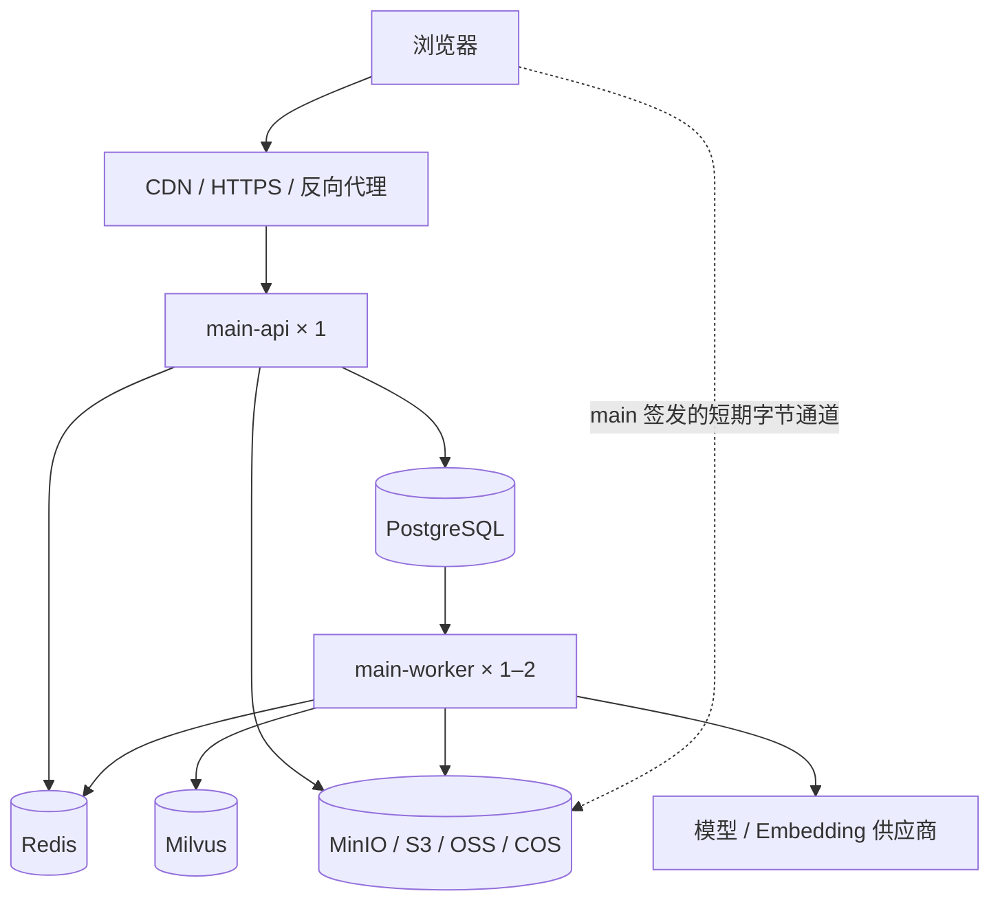
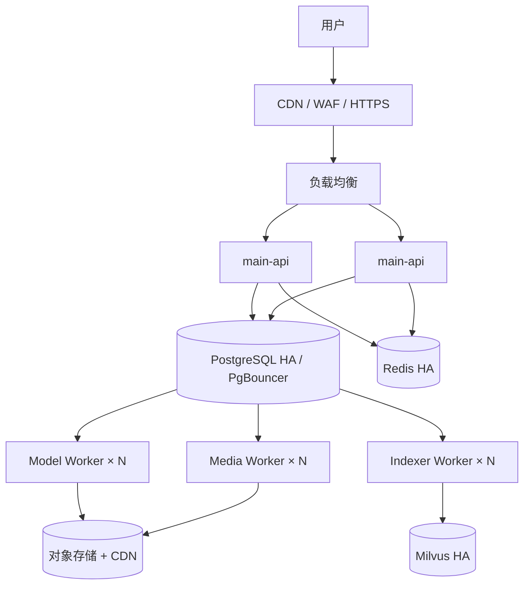
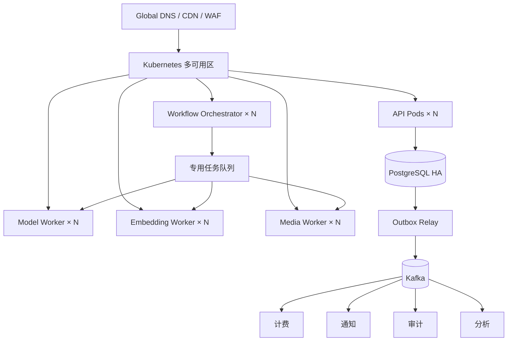

# Lyra 生产部署架构与分阶段演进路线

> 状态：**已定稿的目标架构；Stage 1 集成基线开发中**<br>
> 当前实现：迁移 025–031、API/Worker 分进程、session/workspace、Redis 快照/限流、持久 jobs/Outbox、生产媒体对象投影与向量投影底座；仅限单受信 workspace 试运行<br>
> 更新日期：2026-11-08

本文定义 Lyra 从历史 Early Preview 迁移到可上线初版、增长期和规模化阶段的生产架构。当前分支已落地 Stage 1 集成基线的一部分，但文中的 Stage 1 完成定义、Stage 2 和 Stage 3 仍是演进目标，不代表已经通过目标环境生产验收。

本文是生产演进总纲；数据事件、评测运行和评测目录的具体兼容规则分别见 [DataEvent 与统一事务 Outbox 契约](data-event-contract.md)、[EvaluationRun 契约](evaluation-run-contract.md) 和 [评测数据治理](evaluation-data-governance.md)。详细契约不得把 Stage 1 目标反写成当前现状。

目标方案支持共享多租户 SaaS；私有化部署可为每套系统创建单一默认 `workspace`，保留同样的数据边界。当前实现仍定位为单受信 workspace 试运行，不得仅凭 schema、RLS 或健康探针宣称共享多租户 SaaS 已完成。

## 1. 当前基线与阶段目标

| 能力 | 当前分支：Stage 1 集成基线 | Stage 1 达到目标环境验收还需 | Stage 2：增长期 | Stage 3：规模化 |
| --- | --- | --- | --- | --- |
| API / Worker | 同仓库/同镜像按 `api|worker` 独立进程；Dispatcher、通用 Job Worker、对象/向量 Worker 已常驻 | 将 Production/Asset/Video 旧调度完成迁移，并做租约接管/不重复付费演练 | API 和分类 Worker 水平扩容 | K8s 多可用区调度 |
| PostgreSQL | 迁移 025–031、workspace/session、jobs/Outbox、`NOT NULL + FORCE RLS`；迁移管理员与 `NOBYPASSRLS` 应用角色分离 | 目标环境跨租户/404 验收，自动备份、PITR 与真实恢复演练 | 主备、连接池和条件式读副本 | 表分区；分片最后考虑 |
| Redis | 已用于可重建对话快照和登录/API 分布式限流；限流失败关闭 | 命中/限流压测、边缘 WAF 配置；SSE fan-out 尚未接入 | 托管主从，缓存与协调负载隔离 | Redis Cluster 由容量和吞吐触发 |
| Milvus | v2 租户过滤、持久 index job、fencing/checkpoint/reconciler 已接入；默认关闭时走词法检索 | 显式授权后验证 Collection、全量回填、召回质量和 Alias 切换 | 托管/集群、版本化 Collection 与 Alias 切换 | 多可用区、影子查询与跨区恢复 |
| 媒体存储 | MinIO/S3/OSS/COS 端口、`object_records`、job/Outbox、常驻投影 Worker、生产媒体对象读取和 `/access` 签名入口已接入；导入资产图片仍在 PostgreSQL `asset_media.content` | 资产图片迁移、历史投影、签名公网 HTTPS endpoint/授权边界、云 provider、版本/生命周期与孤儿 GC 验收 | 私有媒体 CDN、版本控制和生命周期 | 跨区域复制和灾备 |
| 事件 | DataEvent V2、租户化 Outbox、Dispatcher、checkpoint Projector 和幂等消费已接入；V1 仅作保留 workspace 兼容 | 目标环境验证积压、重试、重启与 V1/V2 兼容边界 | 通知、计费、索引等多消费者 | Outbox Relay 发布到 Kafka |
| 编排 | 单机 Compose 已包含独立 API/Worker、PostgreSQL、Redis、MinIO 和 Milvus | HTTPS/WAF、Secret Manager/KMS、对象公网 endpoint、监控告警与恢复演练 | 多实例、负载均衡和指标扩容 | Kubernetes，由多机调度需求触发 |

## 2. 不随阶段变化的架构原则

1. **PostgreSQL 是结构化业务状态与元数据的唯一事实源。** 用户、工作区、项目、完整对话、任务、权限、费用、对象引用和 Outbox 均以 PostgreSQL 为准。
2. **对象存储是二进制文件事实源。** 图片、音频、视频、原始文件、中间产物和成片不存入 PostgreSQL、Redis 或 Kafka。
3. **Redis 是必需的加速与协调层，不是事实源。** 对话上下文快照、限流、SSE 广播和短期锁必须可从 PostgreSQL 重建或安全失效。
4. **Milvus 是必需的语义检索层，但仍是派生投影。** 原文、权限和资产状态不以 Milvus 为准；命中后必须回 PostgreSQL 核验。
5. **MinIO、S3、OSS 和 COS 是环境选项，不是四套同时存储。** 应用通过统一 `ObjectStorage` 端口接入，每个环境选择一个主存储。
6. **API 与 Worker 分进程，但不为此拆仓库或微服务。** `@lyra/main` 保持数据与付费主权，`agent` 仍是不监听端口、不持有密钥的纯逻辑库。
7. **跨存储同步不做分布式双写。** 业务事实与 `data_outbox_events` 在同一 PostgreSQL 事务提交，Redis、Milvus 和未来 Kafka 由幂等消费者更新。
8. **付费与秘密边界不因部署改变。** 付费 Embedding/生成任务先经人工授权和预算检查；平台密钥进 Secret Manager，BYOK 按 `workspace_id` 加密保存，明文只在 Worker 内存中短暂存在。
9. **租户边界必须端到端传递。** Repository、Redis key、Milvus scalar filter、对象元数据、任务和事件均携带 `workspace_id`，但权限最终仍由 PostgreSQL 校验。

> 第 2 条是目标不变式，不是对当前迁移进度的过度声明。Stage 1 当前已将生产视频/成片投影到对象存储；历史导入资产图片仍保存在 `asset_media.content BYTEA`，完成对象化迁移前不得声称所有媒体字节已离开 PostgreSQL。

## 3. 数据职责

| 系统 | 保存内容 | 不得承担的职责 | 恢复方式 |
| --- | --- | --- | --- |
| PostgreSQL | 身份、workspace、成员、项目、对话消息、生产运行、任务、费用、对象引用、密钥密文、Outbox | 大型媒体二进制 | 自动备份、PITR、恢复演练 |
| Redis | 对话上下文快照、最近消息窗口、token 计数、限流和短期锁；SSE 临时流是后续目标 | 完整消息、任务最终状态、费用账本 | 从 PostgreSQL 按版本重建；可用 AOF 加速热恢复 |
| Milvus | `workspace_id`、`project_id`、`asset_id`、`chunk_id`、来源版本、Embedding 模型和 vector | 原文、业务状态、权限最终结论 | 从 PostgreSQL/对象存储显式、授权后重建 |
| 对象存储 | 原始文件、图片、音频、视频、中间产物和成片 | 用户权限、任务状态、表关系 | 版本控制、跨区复制、checksum 对账 |
| Kafka（Stage 3） | 可回放的业务事件 | 业务事实源、大型文件、任务最终状态 | 从 Outbox 重放，消费者按 `event_id` 幂等 |

## 4. Stage 1：可上线初版

### 4.1 部署拓扑



当前 `@lyra/main` 已通过 `LYRA_RUNTIME_ROLE=api|worker|all` 支持独立 API/Worker 进程，`deploy/compose.yaml` 使用同一镜像分别启动 `main-api` 与 `main-worker`；`all` 只保留为开发兼容模式。

- 公网只暴露 CDN/反向代理和 API。
- Worker、PostgreSQL、Redis、Milvus 和对象存储管理面仅走私网。
- 云部署优先使用托管 PostgreSQL、Redis、Milvus/Zilliz 与 OSS/COS/S3。
- 私有化可使用 PostgreSQL、Redis、Milvus Standalone 和 MinIO，并配置持久卷与异机备份。
- 初版不引入 Kubernetes、Kafka 或十几个业务微服务。

### 4.2 租户与授权

建立 `users`、`workspaces` 和 `workspace_members`。项目、资产、助手会话、生产运行、任务、模型连接和审计记录均携带 `workspace_id`。

Repository 不允许只按资源 ID 裸查；每次查询必须接收租户上下文。即使 Milvus 和对象 key 包含 `workspace_id`，仍不得以它们替代 PostgreSQL 资源授权。

### 4.3 API 与 Worker

API 只负责认证授权、参数校验、创建任务、查询状态和 SSE 转发。Worker 负责模型调用、Embedding、Milvus 投影、媒体生成和 FFmpeg。

初版至少保持两个独立 OS 进程/容器；Worker 内可先按角色设置不同并发上限：

| 角色 | 主要任务 | 初始并发原则 |
| --- | --- | --- |
| Assistant / Model | 对话、RAG、模型调用 | 按供应商限流，从 2–4 压测 |
| Indexer | 切块、Embedding、Milvus upsert | 受费用授权、模型限流和索引延迟约束 |
| Media | 下载、校验、FFmpeg、上传 | CPU/内存密集，从 1 个 FFmpeg 并发开始 |
| Outbox Dispatcher | 投影、通知、补偿 | 使用 `event_id` 幂等，支持重试和死信 |

### 4.4 对话上下文与 Redis

完整会话继续保存在 PostgreSQL `assistant_sessions` / `assistant_messages`。Redis 保存的是已组装的热上下文，示例 key：

```text
ctx:{workspace_id}:{session_id}
```

快照至少包含 `conversation_version`、`last_message_seq`、摘要、最近消息 ID、token 数、Prompt 版本和过期时间。

```text
写 PostgreSQL 消息并提升会话版本
        ↓
提交 Outbox 事件
        ↓
读取 Redis 快照并比较版本
        ↓
命中：直接使用 / 缺失或过旧：从 PostgreSQL 重建
        ↓
最终助手消息落 PostgreSQL，更新 Redis 快照
```

当前已接入 Redis 对话快照和登录/API 分布式限流；限流依赖故障时失败关闭。Redis Stream/PubSub 的 SSE fan-out 尚未接入，它可作为增长期的推送通道，但完成、失败和费用结果必须落 PostgreSQL，不能以 Redis 临时流代替业务事实。

### 4.5 Milvus 向量索引

Milvus Collection 中至少保存：

```text
chunk_id, workspace_id, project_id, asset_id, source_version,
kind, text_hash, embedding_model, embedding_dimension, vector
```

索引写入流程：

```text
资产/文本版本就绪，PostgreSQL 将投影标为 stale
  → 管理员显式重建，或已授权生产计划明确创建索引动作
  → PostgreSQL 在同一事务写已授权的索引 Outbox
  → Indexer 读取原文、切块、生成 Embedding
  → 按确定性 chunk_id + source_version 幂等 upsert Milvus
  → PostgreSQL 记录 indexed_version / index_status
```

检索时必须使用 `workspace_id` scalar filter，再用命中的 `asset_id/chunk_id` 回 PostgreSQL 核验权限、类型和当前版本。定时 Reconciler 核对漏写、旧版本和删除 tombstone。

普通资产写入只标记投影陈旧，不自动产生付费 Embedding。付费 Embedding 不得因读请求或普通部署自动触发。索引任务必须复用现有付费授权和预算纪律，并保留显式重建入口。

当前持久化 reconciliation/index job、租约、fencing、checkpoint 与 reconciler 已接线；只有 `ASSET_VECTOR_ENABLED=1` 且 Embedding 配置完整时才运行，可能产生费用。默认关闭时仍走词法检索，也不代表目标环境 Collection、全量回填或 Alias 切换已验收。

### 4.6 对象存储

统一端口至少支持 `put/get/head/delete/presignUpload/presignDownload`。数据库只保存：

```text
provider, bucket, object_key, version_id, checksum,
size, content_type, workspace_id, status
```

当前生产媒体主链：

```text
供应商媒体安全下载 + ffprobe/SHA-256 验真
  → storage hook 在 PostgreSQL 创建 object_records + 持久 job/Outbox
  → 租户化对象 Worker 幂等上传
  → head/get 校验 size、类型与 checksum
  → PostgreSQL 标记 ready，session 租户 API 从对象存储读取
```

对象保持私有。`/api/production-media/:id/access` 已提供租户授权后的短期签名入口，但容器内部 endpoint 不等于浏览器可达的公网 HTTPS endpoint；目标云环境仍需验证签名可达性、授权边界和 provider 行为。客户端分片直传和孤儿对象定时 GC 是后续能力，不把当前的 `presign` 端口误写成已完成的全部上传/清理闭环。

### 4.7 可恢复任务与 Outbox

`production_runs` 继续表示业务工作流；高频调度状态拆入任务、步骤和尝试记录，避免心跳和进度持续重写大型 JSONB。

任务执行必须支持原子领取、租约、心跳、超时恢复、指数退避、最大尝试次数、步骤检查点与幂等 key。业务更新与 `data_outbox_events` 在同一事务中提交；消费者允许至少一次投递，用 `event_id` 去重。

### 4.8 安全、可观测性与备份

- 真实登录、workspace 成员授权、HTTPS、可信代理、限流；Cookie 认证时启用 CSRF 防护。
- 平台密钥进 Secret Manager；BYOK 以 KMS 管理的密钥加密存库，API 不拥有常驻解密能力。
- 保留 `/healthz` 兼容，增加 `/livez` 和 `/readyz`；就绪检查区分 PostgreSQL 不可写与 Redis/Milvus 功能降级。
- JSON 日志携带 `requestId`、`runId`、`jobId`、`eventId`，对 API Key、Cookie、Authorization、签名 URL 和供应商原始响应脱敏。
- 指标至少覆盖 API 延迟/错误、最老任务等待时间、Worker 成功率、Redis 内存/命中、Milvus 查询/索引延迟、对象存储错误、Outbox 积压和模型费用。
- PostgreSQL 开启自动备份和 PITR；对象存储开启版本/生命周期；定期演练实际恢复，不只检查“备份存在”。

### 4.9 Stage 1 完成定义

- API 重启不中断 Worker 正在执行的任务。
- Worker 被终止后，租约过期的任务能由新 Worker 恢复。
- Redis 清空后能从 PostgreSQL 重建对话上下文，完整消息不丢失。
- Milvus 不可用时不泄露跨租户数据，保留词法检索降级，不隐式触发付费重建；恢复后能从事实源显式重建索引。
- 对象上传、下载和签名 URL 均通过租户授权与 checksum 验证。
- 重复投递任务/事件不产生重复扣费、重复资产或重复通知。
- 可从 PostgreSQL 和对象存储备份恢复一个项目，并重建对应 Redis/Milvus 派生数据。
- 所有跨 `workspace_id` 的项目、对象、Redis key 和向量访问均被拒绝。

## 5. Stage 2：增长期高可用与水平扩容



本阶段不重写 Stage 1，而是将各组件从“单实例可用”升级为“可独立扩容、可故障切换”。

- API 扩为 2+ 实例，Redis 负责 SSE fan-out 与分布式限流，断线后仍从 PostgreSQL 回查真实进度。
- PostgreSQL 使用托管主备、PITR 和 PgBouncer；读副本仅在实测读压力足够时增加。
- Redis 至少主从自动切换；缓存/限流与需要恢复的 Stream/会话组件先逻辑隔离，必要时物理拆分。
- Worker 按 Model、Indexer、Media 分池，分别依据供应商限流、索引积压和 CPU/内存扩容。
- Milvus 升级为托管版或集群；新 Embedding 模型/维度使用 v2 Collection 回填，通过 Alias 切换，不原地覆盖 v1。
- 对象存储启用分片直传、版本控制、临时对象生命周期和 CDN 签名分发。
- 统一日志、指标和分布式追踪；发布支持滚动更新、优雅停机和 Worker 排空。

Stage 2 不因“到了中期”自动引入 Kafka 或 K8s。任务轮询或锁竞争如果成为 PostgreSQL 明显热点，可将热调度迁到专用任务队列，但 `jobs` 仍保留最终任务状态。

### 5.1 Stage 2 完成定义

- 任意一个 API 实例退出时，负载均衡不再导流，已提交任务继续运行。
- 任意一个 Worker 退出时，完成排空或由租约超时恢复，不重复付费。
- PostgreSQL 主备和 Redis 主从切换经过故障演练，恢复时间与数据丢失窗口满足已定 SLO。
- Milvus v1/v2 Collection 完成数量、召回质量与延迟对比，Alias 可切换也可回切。
- API 和各 Worker 可独立滚动更新；发布期间 SSE 重连能从 PostgreSQL 回查真实状态。
- 对象版本恢复、生命周期和私有 CDN 签名分发完成安全验收。

## 6. Stage 3：规模化事件平台



### 6.1 Kubernetes 的位置

K8s 负责运行和调度计算负载，不代替应用层任务租约、幂等与业务状态。通用 API/编排、网络型 Model Worker、高 CPU Media Worker 和可选 GPU 推理使用不同节点池。

先将 Stage 2 的 API/Worker 原样迁入 K8s，稳定后再拆服务；不同时进行编排平台、数据库、消息和业务边界四项大迁移。

### 6.2 Kafka 的位置

Kafka 放在 Outbox Relay 之后，用于“系统发生了什么”的可回放事件；专用任务队列负责“谁来执行这件事”。

```text
任务队列：GENERATE_SCENE_IMAGE → 一个 Worker 执行
Kafka 事件：SCENE_IMAGE_COMPLETED → 计费、通知、审计和分析各自消费
```

Kafka 不保存媒体，不替代 PostgreSQL。默认使用稳定的 `aggregate_type:aggregate_id` 作为分区键，以保证单聚合的版本顺序；只有业务确实要求租户级全序时才考虑 `workspace_id`，避免大租户分区热点。重复投递依赖消费者幂等。

### 6.3 服务拆分顺序

只在独立扩容、故障隔离、安全权限或团队发布边界明确时拆分。推荐顺序：

1. Notification / Webhook。
2. Billing / Usage。
3. Indexer / Retrieval。
4. Media Processing。
5. Workflow Orchestrator。
6. 项目与生产核心最后考虑。

Model、Embedding、Media、Workflow 等持有模型密钥、连接业务 PostgreSQL、执行付费提交或写媒体的角色，即使独立部署也继续属于 `@lyra/main` 主权边界。通知、计费投影和分析服务只消费版本化事件，不成为新的业务事实源。

PostgreSQL 先做索引、慢查询、连接池、读副本和时间分区；只有单库优化耗尽仍不能满足 SLO 时，才按 `workspace_id` 考虑分片。

### 6.4 Stage 3 完成定义

- K8s 节点排空和单可用区故障时，API/Worker 能跨节点/可用区重调度并满足已定容量与 SLO。
- 专用任务队列的延迟、重试和死信恢复通过故障演练，PostgreSQL 任务最终状态与队列一致。
- Kafka 重复投递、消费者停机、lag 积压、指定范围回放与 Outbox Relay 重启都不产生重复副作用。
- PostgreSQL、对象存储与事件恢复达到明确的 RTO/RPO；Redis 可重建，Milvus 可回填并恢复服务。
- 新拆分服务的权限、数据主权、事件版本和回滚路径通过非作者审查与生产演练。

## 7. Stage 1 升级顺序与当前进度

1. **冻结长期端口（已落地基线）。** `TenantContext`、`ObjectStorage`、`ConversationContextStore`、`VectorStore`、`TaskQueue` 和 `EventPublisher` 已有实现边界；新能力继续只依赖端口。
2. **增加租户模型（代码契约已落地）。** 迁移 025 完成 expand，030 完成 `workspace_id NOT NULL + FORCE RLS` contract；仍需目标环境跨租户回归和连接角色验收。
3. **版本化租户事件契约（已落地兼容基线）。** DataEvent V2、租户化 Outbox、Dispatcher 和 Projector 已接线；历史 V1 仍固定映射保留 workspace，新事件使用 V2。
4. **迁移对象存储（主链已落地，环境迁移未验收）。** 适配器、`object_records`、job/Outbox、投影 Worker、租户化读取与签名入口已接入；仍需历史复制/SHA-256 对账、公网 endpoint、云 provider 和 GC 验收。
5. **接入 Redis（快照/限流已落地）。** 完整消息仍落 PostgreSQL，快照按会话版本回源；SSE fan-out 留待增长期接入。
6. **升级 Milvus 投影（持久任务已落地）。** v2 租户端口、PostgreSQL job/checkpoint/fencing/reconciler 已接线；仍需显式授权后完成 Collection、全量回填、召回校验和 Alias 切换。
7. **分离 API 与 Worker（运行时已分离，业务调度部分迁移）。** Compose 已使用独立进程，持久 Worker 已接线；Production/Asset/Video 旧调度尚未全部迁入通用 jobs，不允许无 fencing 双启。
8. **迁移模型连接（未完成）。** 将共享明文 JSON 迁到加密数据库/Secret Manager/KMS，保留连接版本与运行冻结语义。
9. **补齐边缘安全和运维闭环（部分完成）。** 会话登录/workspace 授权、CSRF、Redis 限流和健康探针已接入；HTTPS/WAF、Secret Manager/KMS、完整监控告警、PITR 与 PostgreSQL/对象存储真实恢复演练完成后，才达到 Stage 1 生产验收。

数据库迁移继续使用独立显式 migrate 入口，不允许 API/Worker 启动时隐式修改 schema。

## 8. 升级触发条件

以下数字是首轮告警建议，最终以压测和业务 SLO 为准。

| 观测到的信号 | 优先动作 |
| --- | --- |
| API CPU 持续超过约 70% 或 p95 延迟违约 | 排查慢请求，再增加 API 实例 |
| 最老待处理任务超过业务允许等待时间 | 扩容对应类型 Worker，不统一扩容 |
| PostgreSQL 连接/轮询/锁竞争成为明显热点 | 先加连接池与索引，再评估专用任务队列 |
| Redis 内存或单主吞吐持续超过容量红线 | 先拆分缓存/协调负载，再考虑 Cluster |
| Milvus 查询延迟、内存或重建时间超过 SLO | 升级托管/集群，新建 Collection 并通过 Alias 切换 |
| 同一事件已有计费、通知、审计、分析等多个独立消费者，且需要长期回放 | 将 Outbox Relay 接入托管 Kafka |
| 已跨 3+ 台主机、5–6 类需独立扩容的负载，人工发布/扩容成为负担 | 评估 Kubernetes |
| 单个 PostgreSQL 完成索引、连接池、读副本和分区后仍无法达标 | 最后才按 `workspace_id` 评估分片 |

## 9. 迁移与回滚原则

- schema 使用“新增可空 → 回填 → 校验 → 强约束 → 观察后删旧”的 expand/contract 流程。
- 租户事件迁移期间 V1/V2 双读，历史 V1 固定映射到默认 workspace 且不改写 digest；回滚可恢复 V1 消费，但切换点后不允许重新产生无租户新事件。
- 对象存储切换使用双读/必要时双写、checksum 核对和延迟删除；观察期内可回退旧存储。
- Milvus 不原地覆盖；新 Collection 完整回填、质量/延迟校验后切 Alias，观察期内可回切。
- Redis 不存唯一业务数据；清空、版本不匹配或回滚时从 PostgreSQL 重建。
- 内嵌调度与独立 Worker 切换使用持久 fencing/feature flag 确保单一领取者；新 Worker 失败时先停止领取、排空、回滚镜像，租约过期后由兼容旧 Worker 接手。
- 模型连接迁移在观察期内保留受控旧读路径，逐条验证 KMS 密文可解密后才停旧；回滚不得把已迁移密钥重新以明文落盘，旧明文文件只在人工确认观察结束后安全销毁。
- Outbox 新消费者可以停止而不影响业务事实提交；影子消费验证后再成为正式下游。
- 回滚和重试不得产生新的重复付费请求；存在供应商任务 ID 时先对账原任务。

## 10. 恢复顺序

完整故障后按以下顺序恢复：

```text
1. PostgreSQL 与租户/项目事实
2. 对象存储与 object_key/checksum 对账
3. API 查询能力
4. Redis 上下文快照按需重建
5. Milvus 缺失或旧版本索引显式回填
6. Worker 与 Outbox Dispatcher 恢复领取和投递
```

高级阶段优先做主区域+备区域的主备，不默认做多地双活。双活只在业务明确要求极低 RTO/RPO，且团队能处理数据库写冲突、重复事件与对象复制延迟时再评估。
