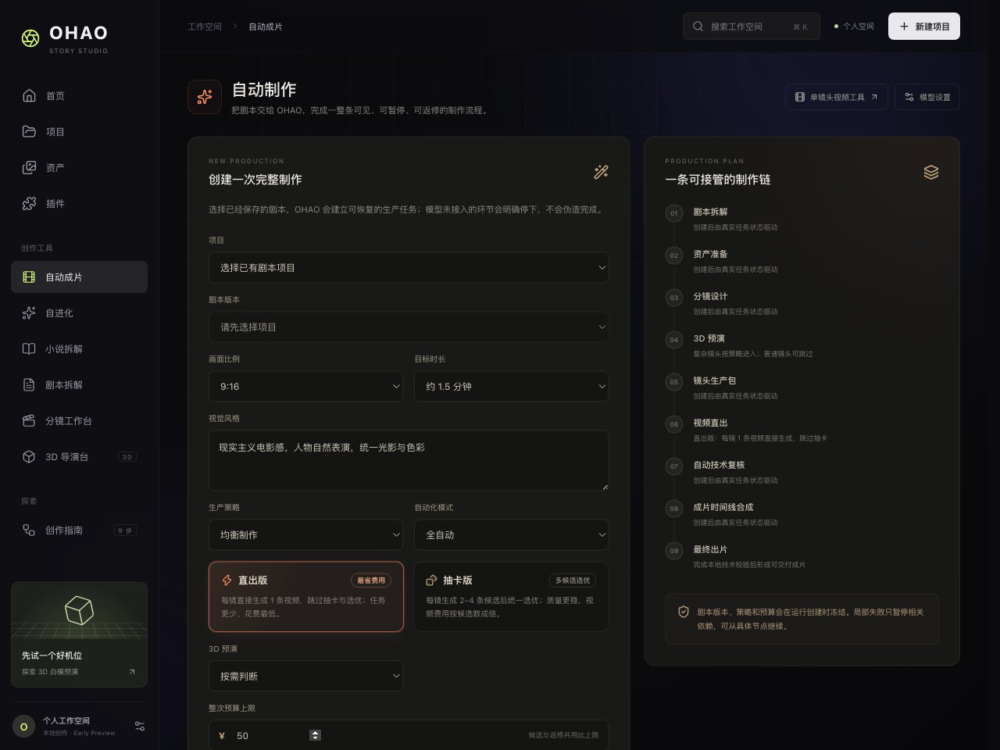
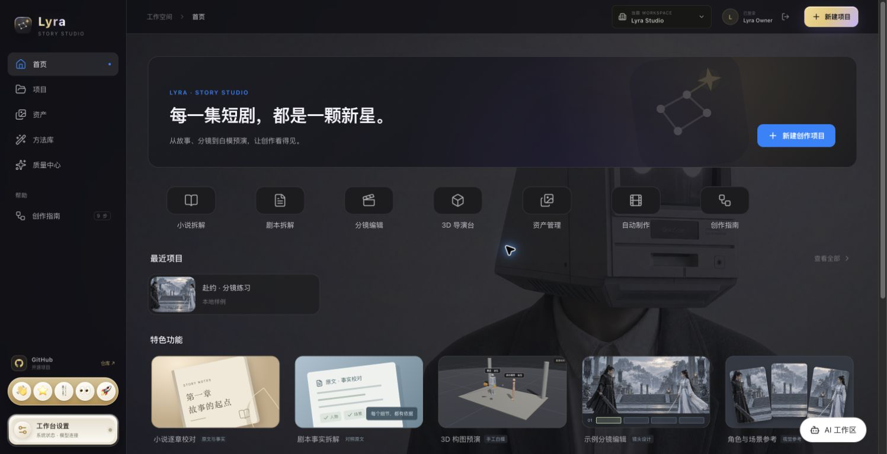
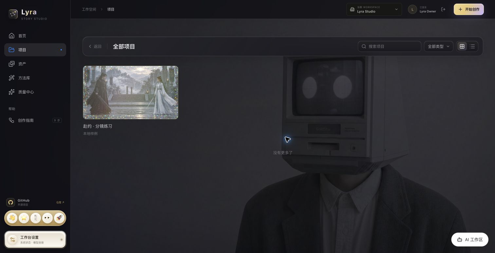
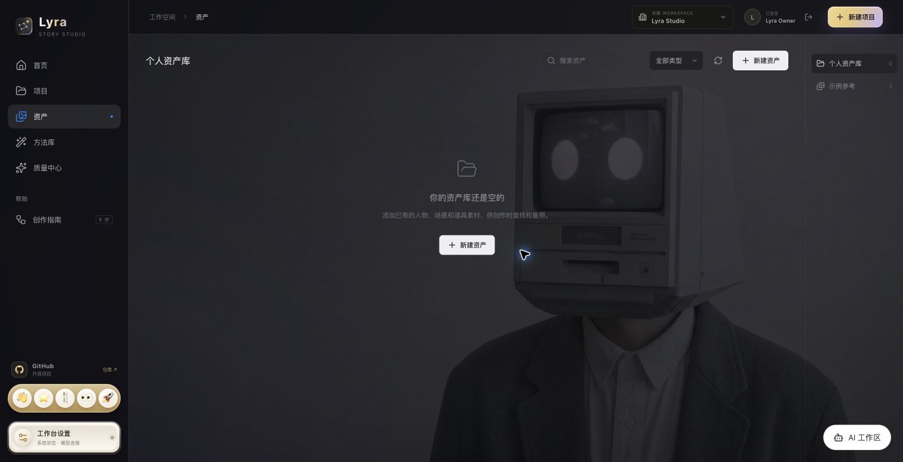
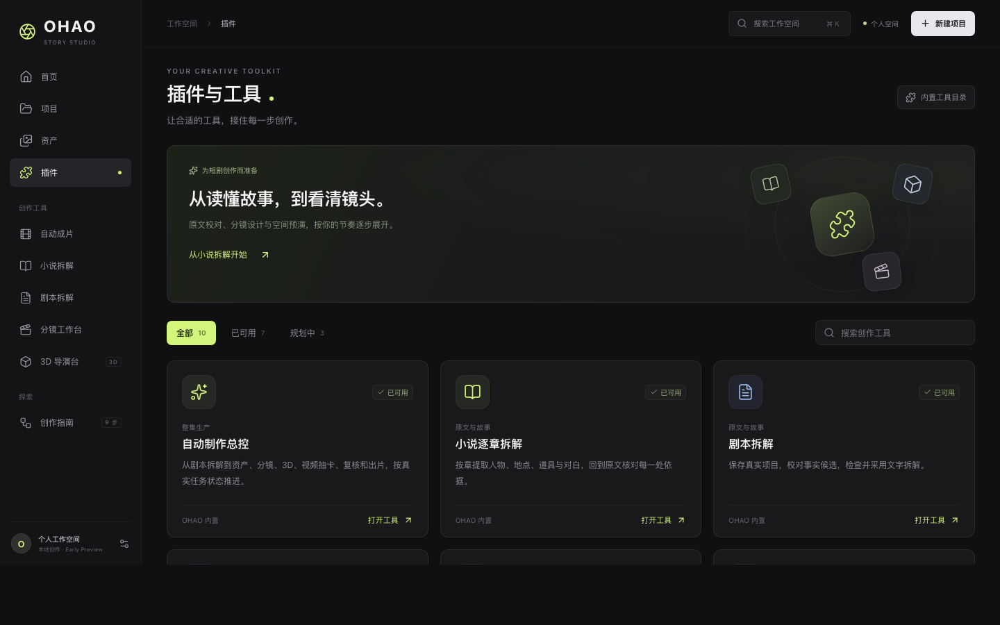
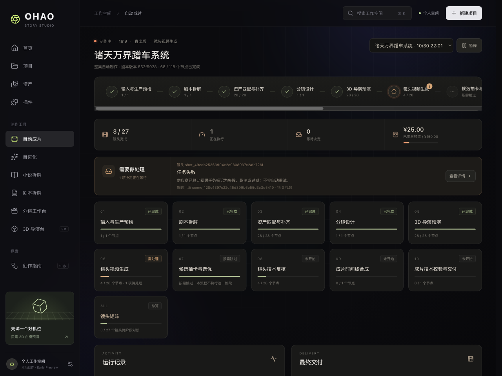
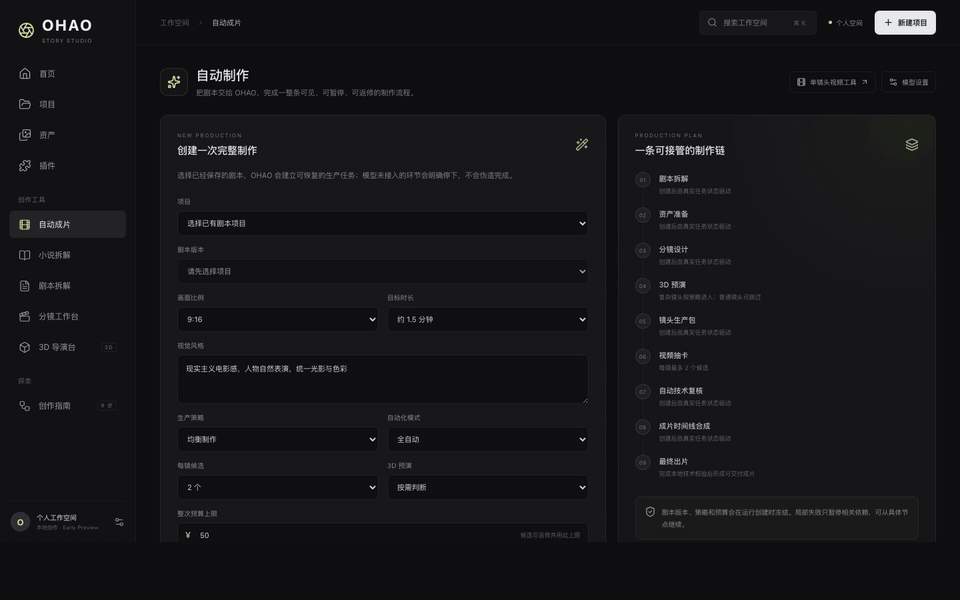
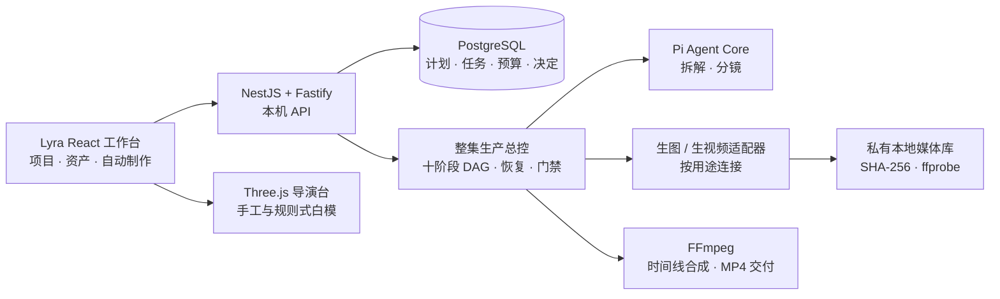

<div align="center">

<h1>Lyra</h1>

<p><strong>把一集剧本，推进成一条看得见、停得住、接得回的自动制片流程。</strong></p>

<p>Shortdrama Agent Lab · 面向中文短剧的本地智能生产工作台</p>

<p>
  
  
  
  
  
  
</p>

<p>
  <a href="#核心亮点整集自动制片">自动制片</a> ·
  <a href="#全新-ohao-工作台">界面预览</a> ·
  <a href="#快速开始">快速开始</a> ·
  <a href="#当前能力与边界">能力边界</a> ·
  <a href="#文档导航">文档导航</a>
</p>

</div>



**首条端到端样片**：[镜 1 成片 · 1920×1080 · 6 秒 · 含音频](docs/media/shot-1-preview.mp4?raw=true)——由一次整集生产运行自动产出：剧本拆解 → 资产引用 → 分镜设计 → 3D 预演约束 → seedance 视频生成 → 本地媒体库入库。

**自进化页面**：保留真实运行、问题、裁决与规则版本的「运行阶梯」，并接入资产检索 P1+P2 治理：终态不可变证据、确定性提案、三参数策略候选、固定离线 Probe、CAS Registry 与人工采用/回滚。推进深度不等同质量提升；Probe 不调用真实模型，不自动修改资产目录或重建 Milvus。详见[资产 RAG 自进化](docs/asset-evolution.md)。

Lyra 已经不只是一个单镜头生成页面。它围绕**一集短剧**建立持久化生产运行，从一次创建开始，把剧本拆解、资产准备、分镜设计、3D 预演、多候选视频、技术复核、局部返修、时间线合成和最终交付接成一条链。每个任务都有真实状态和输入来源；缺少模型、资产、预算或可靠结果时，流程会明确停下，等待处理后从原位置继续。

> 当前是 **Early Preview**。整集生产总控、运行恢复和本地媒体链已经实现；真实模型与媒体生成取决于本机连接配置，并且只会在用户对本次运行明确授权预算后调用。当前自动复核验证容器与哈希，检查画幅、时长和音轨，并读取分辨率参与候选评分；它不代表人物、动作、剧情或审美已经通过语义审核。

## 核心亮点：整集自动制片

### 一键创建，后续步骤自动联动

选择项目和已保存的剧本版本，设置画幅、目标时长、视觉风格、质量档位、制作流程（直出版 / 抽卡版）、3D 策略和预算，即可创建一条可恢复的整集生产运行。直出版每镜只生成 1 条视频并跳过抽卡与选优；抽卡版每镜生成 2–4 条候选后统一选优，视频费用随之成倍。Lyra 会冻结本次输入，沿依赖图继续执行，而不是把彼此孤立的“生成按钮”堆在同一个页面。

后端和运行详情使用十阶段 DAG；创建页把内部预检收进创建动作，并用九个创作者视角的步骤预览后续流程：

| 界面阶段 | 自动联动内容 | 后端阶段 |
| --- | --- | --- |
| 01 剧本拆解 | 从固定剧本版本提取人物、地点、道具和原文依据，并运行确定性检查 | `prepare` + `breakdown` |
| 02 资产准备 | 名称/别名精确匹配优先，未命中时按描述进行结构化 RAG；可选 Milvus + embedding 语义召回。歧义阻断，确实没有合适资产才建立生成任务 | `assets` |
| 03 分镜设计 | 基于已采用事实生成、检查并采用分镜，随后展开镜头级任务 | `storyboard` |
| 04 3D 预演 | 按策略为复杂镜头生成规则式白模，把机位、焦距、运镜和站位转成构图约束 | `director` |
| 05 镜头生产包 | 带着有序资产参考图和导演约束，为每个镜头创建多个带原生音轨的视频候选 | `video` |
| 06 视频抽卡 | 只接收安全下载并进入本地媒体库的 MP4，形成候选组和技术推荐项；直出版跳过本阶段 | `candidates` |
| 07 自动技术复核 | 验证格式与哈希，检查画幅、时长和音轨，读取分辨率参与候选评分；失败项进入有限局部返修 | `review` |
| 08 成片时间线合成 | 按已采用分镜顺序读取选中镜头，合成前先做镜头抽帧质量评估（可关闭），把剔除/裁短/加速转成剪辑指令，再用 FFmpeg 合成整集 | `compose` |
| 09 最终出片 | 重新校验本地成片和冻结目标时长，通过后提供可下载交付 | `deliver` |

### 自动化仍然可控

| 模式 | 适合场景 | 行为 |
| --- | --- | --- |
| **全自动** | 希望系统尽可能推进整集 | 自动采用通过检查的文字候选和技术推荐视频；在质量档位限额内自动建立局部返修。 |
| **关键节点确认** | 希望把握事实、资产、分镜和交付 | 在关键阶段等待确认；视频候选由用户选择。 |
| **共同导演** | 希望逐阶段参与创作 | 每个可见制作阶段进入人工检查点。 |

所有模式都会遵守同一组硬门禁：预算不足、关键事实不明确、资产歧义、模型连接缺失、外部任务状态未知、技术检查失败或重试次数用尽时，受影响节点停止推进。页面的问题收件箱会说明阻断位置、影响范围和下一步动作，不会用一条新的付费提交掩盖结果未知的旧任务。

### 为长流程准备的工程能力

- **镜头级可见性**：运行详情展示包含输入与生产预检在内的十阶段流程轨道，当前推进位置实时可见；点击任一阶段进入该阶段的独立页面（节点列表、待处理问题、候选与交付状态），镜头矩阵提供跨阶段的镜头横向对照，任务输入、候选、检查结果、尝试次数、运行记录和最终交付按所属位置就近呈现。
- **运行级预算**：创建时一次授权整集预算；每次付费操作先预留、后结算或释放，预计超限时自动暂停。
- **暂停与恢复**：运行、任务、尝试、外部操作、产物、问题和决定保存在 PostgreSQL；服务重启后按持久状态恢复。
- **幂等与对账**：稳定请求 ID、CAS 更新和事务 outbox 防止并发覆盖；外部提交结果不明时只查询原任务，不自动重复付费。
- **最小范围返修**：镜头复核失败后，只失效受影响的“视频 → 抽卡 → 复核 → 合片”下游，并把失败项带入新的生成提示。
- **可修复的运行终态**：`partial` 运行不是冷终态——对账（`reconcileOperation`）、放弃外部操作（`abandonOperation`）、强制重跑（`retryTask` + `force`）和加预算都能通过 API 完成，不需要改数据库。
- **失败分类**：版权/内容审核拦截记为 `VIDEO_CONTENT_BLOCKED`（不重试，直接给出“泛化文案、移除人物/道具参考图”的动作）；供应商服务故障才按可重试处理，避免重复付费买同一次拦截。
- **抽帧质量评估**：每镜调用前从运行预算预留 2 元，按外貌、形体、动作、画质四维生成剪辑建议。缺少有效建议的镜头沿用普通剪辑；预算不足或供应商结果未知时等待处理。总控里的抽帧费用为运行内估算。
- **本地可信交付**：远程视频必须先安全下载、计算 SHA-256 并经 `ffprobe` 校验，合片只读取受控本地媒体 ID。

完整的状态机、媒体安全、预算语义与恢复规则见 [Lyra 全流程自动制片实现](docs/Lyra全流程自动制片实现-v0.1.md)。

## 全新 Lyra 工作台

新版界面统一为克制的深色电影工作台：固定侧栏连接首页、项目、资产、插件与自动制作；内容区保持更大的留白和清晰的任务层级。首页负责进入创作，项目负责承载剧本，资产负责沉淀可复用素材，插件页集中展示生产工具，而自动制作页把这些能力编排为完整流程。

| 首页 | 项目 |
| --- | --- |
|  |  |

| 资产 | 插件 |
| --- | --- |
|  |  |

**自动制作流程概览**



> 2026-10-30 更新：运行总控已改版为「流程轨道 + 总览 + 每阶段独立页面 + 镜头矩阵」结构；上图为改版前截图，待新版界面确认后更新。

<details>
<summary>查看当前 Lyra 界面导览</summary>

[](docs/media/product-tour.mp4?raw=true)

<p align="center"><a href="docs/media/product-tour.mp4?raw=true">打开 / 下载 MP4 演示</a></p>

导览由当前自动制作、首页、项目、资产和插件页面截图制作，仅展示产品界面，不代表模型已经完成真实生成。

</details>

## 创作依据与手工控制

自动制片建立在可核对的原文、资产和采用记录上。除了整集总控，Lyra 仍保留适合逐步创作和校对的工作区。

### 小说与剧本事实链

「小说逐章拆解」保留小说原文，按章核对人物、场景/地点、道具和对白；每项带可定位的原文依据，心理活动、引用和身份不明内容可以留待确认。校对后保存不可变新版本，原文条目变化时提醒重新检查资产关联。详见 [小说逐章拆解](docs/小说逐章拆解.md)。

「真实项目」保存剧本版本、事实候选、程序检查、采用决定和分镜候选。用户可以对照原文修改名称、别名和说明，再保存新候选；旧版本和依据不会被覆盖。

### 可复用资产库

人物、场景和道具可以登记 HTTPS 素材或导入本地 PNG、JPEG、静态 WebP。待补条目可整理为带原文事实、依据、设计变量和负面约束的 `AssetVisualBrief`，生成候选经过人工确认后才成为正式关联。独立资产候选工具采用逐张额度授权；整集自动制作则使用本次运行的预算授权。

自动制片的资产检索顺序固定为“名称/别名精确匹配 → 本地结构化词法 RAG + 可选向量语义召回 → 唯一高置信复用 → 缺失才生图”。默认不启用向量服务；配置自己的 `ASSET_EMBEDDING_*`、`MILVUS_*` 并设置 `ASSET_VECTOR_ENABLED=1` 后，Milvus 只保存可重建投影，命中仍回到当前资产目录核验，陈旧 ID 和跨类型结果会丢弃。资产目录始终是事实源，不使用旧 Main 的账号或部署。

向量索引不会在制片准备阶段隐式同步。导入或修改资产后，需要显式执行以下命令；它会读取正式资产目录并可能产生 embedding 费用：

```sh
npm run assets:vector-rebuild
```

查询 embedding 进入运行预算与实际费用记录；`prepare()` 不发起 embedding 网络请求。Milvus/网络等可重建故障会保留词法降级并记录诊断，非法响应契约不会被伪装成正常降级。所有模式继续使用 `0.62` 复用阈值与 `0.08` 歧义间隔，只有唯一高置信结果会自动复用。

### 模型连接按用途隔离

在「模型设置」保存多套连接，并分别指定拆解、生图、生视频和通用用途。DeepSeek、Kimi、Sol、Terra 与豆包 Seedream/Seedance 可以同时保留，切换用途无需重填密钥。密钥仅保存在本机后端的忽略目录中，页面不回显；任务会冻结创建时的用途选择和版本，也不会跨用途静默回退。详见 [独立模型配置](docs/独立模型配置.md)。

### 浏览器内 3D 导演台

3D 导演台支持人物体型与姿势、关节微调、几何物体、群众阵列、本地 GLB、机位、焦段、光照、画幅和构图线。场景可在本地保存，支持 JSON 导入导出、PNG、机位宫格、深度图和 3 / 5 / 8 秒 WebM 运镜片段。整集生产中的自动白模是规则式空间预演，并通过文字 prompt 约束视频任务；它目前不会把 3D 渲染图或供应商原生相机参数直接传给视频模型。

## 快速开始

### 仅体验新版界面

准备 **Node.js ≥ 22.19** 和 npm。只浏览首页、项目样式、资产、插件、示例工作台和 3D 导演台时，不需要数据库或模型账号。

```sh
git clone https://github.com/K80Tom/frame-shortdrama-agent.git ohao
cd ohao/packages/main
npm --prefix web ci
npm --prefix web run dev
```

打开 [http://127.0.0.1:5173](http://127.0.0.1:5173)。仅启动前端时，示例草稿保存于浏览器 localStorage，3D 场景保存于 IndexedDB；清理网站数据会删除这些本地内容，请先从页面导出。

### 启动完整本地服务

准备 Docker Desktop（或可用的 Docker Compose 环境），在 `packages/main/` 执行：

```sh
npm ci
npm run db:setup
npm run db:up
npm run db:migrate
npm run dev
```

`db:setup` 会从示例配置初始化本地 `.env`、补齐随机数据库密码并保留已有模型设置。迁移必须通过 `db:migrate` 显式执行，服务不会自行修改数据库。后端默认监听 `http://127.0.0.1:8788`。

另开一个终端启动前端：

```sh
npm --prefix web ci
npm --prefix web run dev
```

常用入口：

- [首页](http://127.0.0.1:5173/#/studio)
- [真实项目](http://127.0.0.1:5173/#/production)
- [整集自动制作](http://127.0.0.1:5173/#/automation)
- [单镜头视频工具](http://127.0.0.1:5173/#/automation/video)
- [小说逐章拆解](http://127.0.0.1:5173/#/novel)
- [3D 导演台](http://127.0.0.1:5173/#/director)
- [模型设置](http://127.0.0.1:5173/#/settings/models)

首次运行自动制片前，请在「模型设置」为拆解、生图、生视频和通用用途配置所需连接，然后创建项目并保存剧本版本。打开「自动制作」，选择项目和剧本，设置策略与预算；只有勾选“本次运行允许调用已配置的付费模型”后，后端才会接受创建请求。

已有数据库升级时也要执行 `npm run db:migrate`：当前整集生产总控使用迁移 015，Agent 自动采用约束使用迁移 016，事实提取账本保存已付费模型响应使用迁移 017，AI 工作区会话与估价确认卡使用迁移 018。未应用 017 时后端不启动付费事实提取，整集总控也不会启动；未应用 018 时 AI 工作区返回未就绪。完整数据库、端口和故障排查说明见 [本地开发](docs/本地开发.md)。

## AI 工作区：旁边的对话式助手

工作台右侧新增全局 **AI 工作区**（旧平台「全局 AI 工作区」的本地等价实现）：

- **打开方式**：右下角「AI 工作区」浮动按钮，或 `⌘J / Ctrl+J` 收起与展开。
- **上下文感知**：进入具体项目页时，会话自动关联当前项目；不同上下文的消息互相隔离，刷新后可回放。
- **真实数据查询**：助手只能通过白名单只读工具获取信息（项目清单、制片运行列表与详情、资产目录），工具返回经过字段与条数裁剪，模型发明的工具名一律拒绝执行。
- **流式事件协议**：`text_delta / thinking_delta / tool_start / tool_end / generation_quote / done / error`，前端以 SSE 接收；当前上游模型为非流式调用，回答在完成后分段下发，不伪造思考过程。
- **付费只走估价卡**：助手可以按你的要求生成「自动制片估价确认卡」，但**建卡不扣费**。卡片冻结创建请求、以预算为费用上限、15 分钟有效，你点「确认并提交生产」后才真正创建运行；重复确认幂等，过期拒绝。对话内估价卡预算上限 50 元，更高预算请在自动制片页人工创建。
- **禁 mock**：模型未配置或调用失败时，消息如实标记失败并给出人话错误，不生成模拟回答。

工程位置：后端 `src/assistant/`（契约、Orchestrator、工具、SSE 控制器、PostgreSQL 持久化），前端 `web/src/assistant/`，数据库迁移 `018_assistant_workspace.sql`，测试 `tests/assistant.test.cjs`。

## 当前能力与边界

| 能力 | 当前状态 |
| --- | --- |
| Lyra 产品界面 | 已实现首页、项目、资产、插件、工作台、自动制作和设置等统一导航与新版视觉。 |
| 整集生产运行 | 已实现 PostgreSQL 持久化十阶段 DAG、镜头子图、幂等创建、CAS 更新、事务 outbox、预算、暂停/继续、重启恢复、外部任务对账、局部失效与重试。 |
| 剧本与分镜 | 已实现原文索引、事实候选、依据核对、程序检查、人工/Agent 采用、分镜生成与镜头任务展开。 |
| 资产联动 | 已实现人物、场景、道具的名称/别名匹配、描述与原文依据的结构化 RAG、可选 Milvus 语义召回、相关性阈值与同级歧义阻断、未命中图片生成、本地导入和镜头有序参考图绑定。 |
| 3D 导演台 | 已实现手工摆场和浏览器渲染导出；生产总控可按确定性规则生成白模快照，并把机位、运镜和人物站位转成 prompt 约束。 |
| 视频生产 | 已实现每镜多候选、供应商原生音频、安全下载、内容寻址本地媒体库、`ffprobe` 校验、技术抽卡和携带失败项的有限返修。 |
| 成片交付 | 已实现按分镜顺序的 FFmpeg 合片、本地 MP4、不可变时间线清单和最终技术复核。 |
| 镜头质量评估 | 合成前逐镜预留、抽帧打分并保存剪辑建议。合片重试复用已有评估，调用结果未知时等待对账。 |
| AI 工作区 | 已实现全局对话侧栏、上下文会话、白名单只读工具、SSE 事件流与自动制片估价确认卡；助手不能自行扣费。 |

当前明确不包含：

- 人物长相、动作、剧情、台词、表演和连续性的**完整**视觉语义自动审核（当前只做单镜头抽帧四维打分与剪辑建议，不做跨镜头连续性判定，也不自动重生成）；
- AI 对 3D 白模画面的视觉理解和自动精调；
- 独立配音、口型同步、音效、配乐、混音、字幕生成和烧录；
- 供应商最终账单自动回填；
- 面向生产环境的分布式调度、对象存储、CDN 和多用户权限。

因此，“技术复核通过”表示本地文件及媒体指标符合程序条件，不等于镜头内容已通过审美或剧情审核。抽帧评估只读取画面并给出剪辑建议，不会自动重生成镜头。离线测试也不会调用真实付费模型；完整内容质量仍需在配置模型、明确授权试运行后由人观看验收。

## 工程结构

主工程使用 TypeScript。React + Vite 负责创作与生产总控界面；NestJS + Fastify 提供本机 API；Pi Agent Core 执行文字阶段；PostgreSQL 保存项目、候选、任务、预算与事件；本地媒体链用 SHA-256、ffprobe 和 FFmpeg 管理视频与交付。



```text
packages/main/
├── web/                React 工作台、生产总控与浏览器 3D 导演台
├── src/                本机 API、Agent 内核、生产编排与媒体适配
├── migrations/         PostgreSQL 显式迁移
├── tests/              契约、状态机、HTTP、媒体与持久化测试
├── scripts/            数据库准备、集成验证与模型检查
├── examples/           剧本练习与手写数据样例
├── docs/               产品、架构、接入、边界与演示媒体
└── flow-explainer/      独立保留的九步流程讲解页
```

### 开发验证

```sh
npm test
npm run build
npm --prefix web test
npm --prefix web run build
```

数据库已启动并完成迁移后，还可以运行：

```sh
npm run test:db
```

这些命令不提交真实付费任务。数据库集成测试只创建并清理自己的测试项目；测试通过不能代替模型输出和成片内容的人工验收。

## 路线图

- [x] 统一的 Lyra 首页、项目、资产、插件、工作台与设置界面。
- [x] 原文索引、项目持久化、受控文字阶段、确定性检查与候选采用。
- [x] 人物、场景和道具资产库，以及待补图片的生成、导入与人工采用。
- [x] 浏览器内手工 3D 白模与规则式镜头预演。
- [x] 项目级十阶段生产 DAG、镜头子图、运行预算、跨重启恢复和问题门禁。
- [x] 每镜多视频候选、技术抽卡、有限局部返修和供应商任务对账。
- [x] 本地时间线、FFmpeg 合片、程序化成片复核和可下载 MP4 交付。
- [ ] 用真实模型持续验收拆解、分镜和视频内容质量，扩展跨镜头连续性与内容安全复核（单镜头抽帧四维评估已实现并接入合成）。
- [ ] 扩展实体增删合并、场次/对白编辑、候选差异比较和按场重做。
- [ ] 增加独立声音、口型、字幕流程和可继续编辑的专业时间线工程。
- [ ] 建立适合多人和远程部署的权限、对象存储与分布式调度能力。

首批整集目标为真人拟真、约 1–2 分钟、竖屏 9:16、中文对白。路线图的完成标准以 [总体设计](docs/总体设计.md) 为准。

## 文档导航

| 想了解什么 | 从这里开始 |
| --- | --- |
| 整集自动制作、恢复、预算、媒体链与边界 | [全流程自动制片实现](docs/Lyra全流程自动制片实现-v0.1.md) |
| 真实跑批暴露的问题、根因与重构记录 | [流程问题诊断与重构](docs/流程问题诊断与重构-v0.1.md) |
| 自动制片的产品构思与长期方向 | [全流程自动制片构思](docs/Lyra全流程自动制片构思-v0.1.md) |
| 产品目标、创作边界与里程碑 | [总体设计](docs/总体设计.md) |
| 已实现架构与后续设计 | [技术架构](docs/技术架构.md) |
| 数据契约、运行聚合与版本 | [数据结构 v0.1](docs/数据结构-v0.1.md) |
| 本地启动、数据库、迁移与排错 | [本地开发](docs/本地开发.md) |
| 前端入口、操作与浏览器保存范围 | [工作台说明](../web/README.md) |
| 模型用途、配置与调用限制 | [模型接入](docs/模型接入.md) · [独立模型配置](docs/独立模型配置.md) |
| 独立单镜头视频工具 | [单条视频自动化](docs/单条视频自动化.md) |
| 小说事实与资产链 | [小说逐章拆解](docs/小说逐章拆解.md) · [小说资产引用](docs/小说资产引用.md) |
| 当前文字链路与 API | [首个里程碑实现](docs/首个里程碑实现.md) |
| 深入查看阶段实现 | [持久化](docs/持久化-P0.2.md) · [事实候选](docs/候选计划-P0.3.md) · [受控阶段执行](docs/受控阶段执行-P0.4.md) |
| 示例、来源与开发约定 | [示例说明](examples/README.md) · [AGENTS.md](AGENTS.md) · [第三方说明](../web/THIRD_PARTY_NOTICES.md) |

## 仓库结构（monorepo）

**本包是 Lyra 的数据与付费主权层。** 仓库按 `packages/{shared,main,agent,web,cli}` 组织：

| 路径 | 用途 |
| --- | --- |
| `../shared/` | 公共契约与类型（模型、生产、资产、小说领域），零服务依赖。 |
| `../main/`（本包） | NestJS API、PostgreSQL 与迁移、生产 DAG、媒体链、模型密钥。 |
| `../agent/` | 智能能力层：AI 工作区编排、只读工具、估价状态机；不持密钥、不连数据库。 |
| `../web/` | React 工作台（含 AI 工作区侧栏），只调本包 API。 |
| `../cli/` | 命令行客户端，只调本包 API；付费遵循 计划 → 人工确认 → 提交。 |
| `../../reference/` | 旧平台精选参考（合同 / 架构 / 拆解实现），只读，不参与构建。 |

跨包边界与命令见根目录 [AGENTS.md](../../AGENTS.md)。旧平台完整工程已从仓库移除，可从 Git 历史找回；启动本项目不依赖旧平台的 Main API、数据库、账号或部署配置。

## 来源与许可

3D 导演台按明确授权从同仓旧平台迁入并完成独立运行适配，具体来源与改动见 [第三方代码说明](../web/THIRD_PARTY_NOTICES.md)。React Bits 组件的原始许可保留在 [REACT_BITS_LICENSE.md](../web/src/vendor/REACT_BITS_LICENSE.md)。

本项目尚未声明统一开源许可证；公开代码与演示不等于授予整体再分发或商用许可。使用或分发第三方代码、样例与素材前，请核对各自来源及许可。

---

<div align="center">
  <p><strong>让一条自动化流程，保留每一个可追溯的创作决定。</strong></p>
  <p><a href="#快速开始">本地体验 Lyra</a> · <a href="https://github.com/K80Tom/frame-shortdrama-agent/issues">反馈问题与想法</a></p>
</div>
